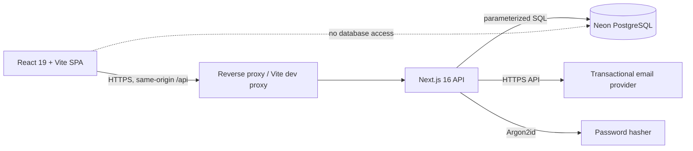
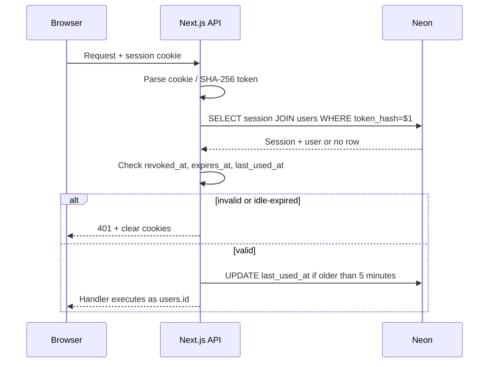
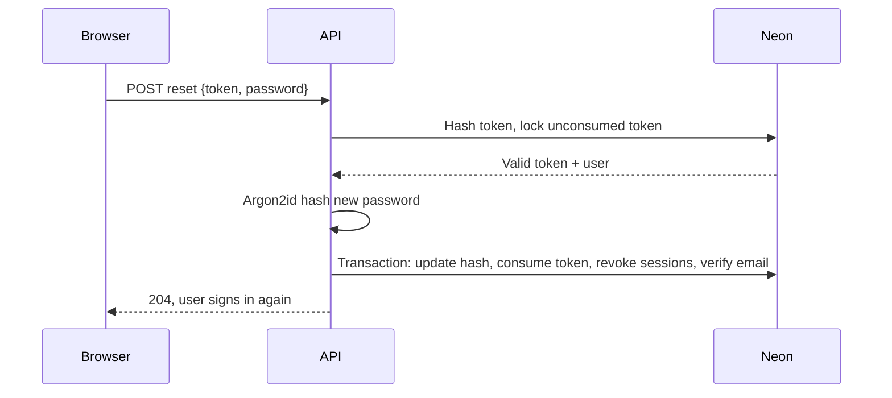

# Authentication Architecture — GrowSpace

Last updated: 2026-10-20

Status: proposed Firebase-free authentication design. This document is part of Phase 3A and does not implement code, add dependencies, execute SQL, or change runtime behavior.

Related documents:

- `docs/database/discovery.md` — current Firebase/data inventory.
- `docs/database/schema.md` — `users`, `sessions`, `auth_tokens`, `auth_rate_limits`.
- `docs/database/migration-plan.md` — schema and data cutover.
- `docs/auth/firebase-exit-plan.md` — dependency removal and release gates.

## 1. Goals and non-goals

### Goals

1. Replace Firebase Authentication with first-party email/password authentication.
2. Store identities, password hashes, sessions, and one-time tokens in Neon PostgreSQL.
3. Use server-managed opaque sessions in secure cookies; do not store authentication tokens in browser storage.
4. Enforce authorization on the server for every private read and write.
5. Provide email verification and password reset without revealing whether an email is registered.
6. Resist credential stuffing, session theft, CSRF, replay, and account enumeration.
7. Remove Firebase Auth, Firebase Admin, Firestore, Firebase configuration, and Firebase SDKs after cutover verification.
8. Preserve the existing Vite/React UX and Next.js API envelope where practical.

### Non-goals

- MFA, passkeys, social login, magic-link-only login, or SSO.
- Admin roles or staff impersonation.
- Account deletion or self-service password change in the initial replacement.
- A native mobile app or public API tokens.
- Real-time session revocation infrastructure beyond database checks.
- Changes to garden/plant domain behavior.

## 2. System shape



- The browser never holds a Firebase token, JWT, password hash, or database credential.
- The browser holds an `HttpOnly` session cookie and a CSRF cookie.
- `apps/api` is the only PostgreSQL client and the only component that verifies passwords.
- Neon stores opaque session hashes, not raw session tokens.
- Email delivery is external; the API creates the token and sends the link.

### 2.1 Deployment topology

**Recommended: same-origin deployment.** Serve the SPA and `/api` from the same site, for example `https://app.example.com` with `/api/*` reverse-proxied to the Next.js API. This permits `__Host-` cookies and avoids third-party-cookie restrictions. The Vite dev server already proxies `/api`; production must do the equivalent.

**Cross-origin fallback** is not part of the initial implementation. It is possible but weaker:

- `ALLOWED_ORIGINS` must be an exact allowlist; no wildcard.
- CORS must enable credentials and `X-CSRF-Token`.
- Cookies need `SameSite=None; Secure`, which browsers may block as third-party cookies.
- Origin checks and CSRF remain mandatory.
- Because the SPA cannot read an API-domain CSRF cookie, cross-origin mode must return the raw CSRF token in login/session responses and keep it in memory, then rotate it on a full reload. That creates multi-tab complexity and requires a separate approved design.
- Avoid this topology unless same-origin routing is impossible.

The API must not be exposed on a different registrable domain with a shared cookie `Domain`.

## 3. Identity and data model

### 3.1 Internal users

`users.id` is a UUID and the only ownership key. Firebase UIDs are not stored in application tables and are not accepted from clients. Per the confirmed product decision, GrowSpace starts fresh with new user registrations; no legacy UID mapping tables or legacy accounts exist.

A public session user shape:

```ts
type SessionUser = {
  id: string;              // users.id UUID
  email: string;
  displayName: string | null;
  temperatureUnit: 'celsius' | 'fahrenheit';
  emailVerified: boolean;
  createdAt: string;       // ISO timestamp
};
```

Never return `password_hash`, token hashes, Firebase fields, database errors, or session internals.

### 3.2 Profile behavior

The previous Firebase `Profile` concept is folded into `users`:

- `displayName` is optional and editable by the authenticated user.
- `temperatureUnit` defaults to `celsius` and is persisted.
- `email` is read-only in the initial replacement; changing it requires a re-verification flow and is not implemented.
- `emailVerified` is derived from `users.email_verified_at`.

### 3.3 Authorization context

Every private route handler must:

1. Resolve the session cookie.
2. Load the session and user in one query.
3. Reject missing, expired, idle-expired, or revoked sessions.
4. Derive `userId` from the session only.
5. Scope every query/mutation by `userId`.
6. Return a non-disclosing error for records outside the user's scope.

`requireSession()` is a server-side API helper, not a UI guard. `ProtectedRoute` in the SPA is a UX convenience and must not be the security boundary.

## 4. Password handling

### 4.1 Algorithm

- Use **Argon2id**, encoded in PHC string format (`$argon2id$v=19$m=...,t=...,p=...$...`).
- Recommended implementation: `@node-rs/argon2` (maintained, async, native). Alternative: `argon2`. Do not use a general-purpose SHA/MD5 hash.
- Proposed parameters: memory `19456` KiB (19 MiB), iterations `2`, parallelism `1`, output length `32`, random salt `16` bytes. This matches an OWASP Argon2id baseline; re-benchmark on the deployment host.
- The database accepts only a hash beginning with `$argon2id$` (`users.password_hash` check).
- Never log, return, or email passwords or hashes.

`bcryptjs` is not part of the approved schema design. It is a fallback only if native Argon2 cannot be deployed and the `users.password_hash` check is explicitly changed. Bcrypt has a 72-byte input limit and needs explicit truncation avoidance; it is not the preferred design.

### 4.2 Password policy

- Minimum 12 characters, maximum 128 characters, maximum 1,024 UTF-8 bytes.
- Accept spaces and Unicode; do not trim, collapse, or Unicode-normalize passwords.
- No composition rules, no forced rotation, no security questions.
- Confirm-password is a client concern; the server validates one password value.
- Allow paste and password-manager autofill.
- Reject empty/whitespace-only values but preserve internal and leading/trailing characters after validation.
- Apply the same policy to registration, reset, and any future password change.
- Mark 12 characters as a proposed product change: the current UI copy says 8. If the product requires 8, document the risk; do not silently accept 8 in the API while the UI says 12.

Optional later: breached-password checks against a k-anonymity API. Do not add one now.

### 4.3 Verification and rehash

- Parse the stored PHC parameters during login.
- If the hash is valid but parameters are below the current target, rehash the password after successful verification and update `password_hash`.
- If verification fails, use a dummy Argon2id verification for nonexistent users or users with no password hash to reduce timing differences.
- Limit concurrent hashing to avoid CPU exhaustion; queue or reject excess work after rate limiting.
- Never compare password strings with `===`.

### 4.4 Migration-only password handling (Omitted — Fresh Start)

**Status: OMITTED (Confirmed Product Decision)**

GrowSpace has no existing Firebase accounts that need migration. The application starts fresh with new user registrations.
- `users.password_hash` is strictly `NOT NULL` and enforces Argon2id format (`CHECK (password_hash LIKE '$argon2id$%')`).
- No accounts with `password_hash = NULL`, legacy password migration stores, or bulk reset campaigns exist.

## 5. Session design

### 5.1 Token and cookie

| Item | Proposed value |
| --- | --- |
| Session token | 32 cryptographically random bytes, base64url |
| Server storage | SHA-256 token hash in `sessions.token_hash` (`bytea`, 32 bytes) |
| Session cookie name | `__Host-gs_session` in production; `gs_session` in local HTTP dev |
| Session cookie flags | `HttpOnly; Secure` (production); `SameSite=Lax`; `Path=/`; no `Domain` |
| Session cookie lifetime | `Max-Age=604800` (7 days) |
| Absolute session lifetime | 7 days |
| Idle timeout | 24 hours |
| Last-used update | At most once every 5 minutes |
| CSRF cookie | `__Host-gs_csrf` production; `gs_csrf` dev; non-HttpOnly (same-origin mode) |
| CSRF header | `X-CSRF-Token` |

`__Host-` cookies require HTTPS, `Secure`, `Path=/`, and no `Domain`. In local HTTP development, use the unprefixed dev names and set `Secure` off only when `NODE_ENV !== 'production'`. Never infer cookie security solely from a client header; use an explicit server setting or the deployment environment.

Cookies are not signed JWTs. The raw token is high entropy and is validated by hash lookup. Revocation is immediate at the database level.

### 5.2 Session creation

On successful login:

1. Generate a new 32-byte session token and a new 32-byte CSRF token.
2. Hash both with SHA-256.
3. Insert a `sessions` row with `user_id`, hashes, `expires_at = now() + 7 days`.
4. Revoke any existing session presented by the same browser, if valid.
5. Set both cookies.
6. Return the public user shape and `Cache-Control: no-store`.

A new token is always generated after authentication. Never reuse a pre-login cookie as an authenticated session. This prevents session fixation.

Multiple independent devices may hold separate sessions. Login does not revoke other devices unless policy changes.

### 5.3 Session validation



Checks, in order:

1. Cookie exists and decodes to the expected length.
2. Hash lookup returns a row.
3. `revoked_at IS NULL`.
4. `expires_at > now()` (absolute).
5. `last_used_at > now() - 24 hours` (idle).
6. User still exists.
7. CSRF token is checked for unsafe methods.

If idle-expired or revoked, delete/revoke the row and clear both cookies. Return `401` without revealing why.

The database update for `last_used_at` may be throttled and should not block every request unnecessarily. Do not extend `expires_at` on activity; the 7-day limit is absolute.

### 5.4 Session rotation and revocation

- Rotate the session token on login. A later enhancement may rotate on privilege or password change.
- Do not rotate on every request; that breaks concurrent requests.
- Logout revokes the current session and clears cookies. It is idempotent.
- Successful password reset revokes all sessions for that user.
- A server-side “revoke all” operation updates every non-revoked session row.
- Account deletion, if added, deletes sessions by cascade.
- Expired/revoked rows are cleaned up periodically; retain a short security window only if needed for investigations.

### 5.5 CSRF strategy

Use defence in depth for the supported same-origin topology:

1. **Same-origin deployment** and exact Origin checks.
2. **`SameSite=Lax`** session cookie.
3. **Session-bound double-submit CSRF token**:
   - The raw CSRF token is in a non-HttpOnly `__Host-gs_csrf` cookie.
   - The SPA reads it and sends it as `X-CSRF-Token`.
   - The server checks the header equals the cookie and `SHA-256(header)` equals `sessions.csrf_token_hash`.
4. **No state-changing GET/HEAD/OPTIONS requests.**
5. **CORS** never uses `*` for credentialed requests.

For authenticated unsafe methods (`POST`, `PUT`, `PATCH`, `DELETE`):

- Reject if `Origin` is absent or not in the exact allowlist.
- Reject if CSRF header/cookie is missing or mismatched.
- Do not accept a CSRF token from a query string or request body.

Unauthenticated endpoints (`login`, `register`, `forgot-password`, email-link completion) still validate Origin/Referer and use rate limits. There is no session CSRF token before login. Email tokens provide proof of mailbox control for verify/reset.

**Cross-origin exception:** the double-submit cookie above only works when JavaScript can read the API-domain CSRF cookie. In a cross-origin fallback, return the raw CSRF token in the login/session response, hold it in memory, and rotate it when a full page load obtains a new session response. Do not weaken the server-side hash check. Multi-tab behavior must be tested before using this mode; it is not the initial design.

`SameSite=Lax` is proposed rather than `Strict` so normal top-level navigation into the app does not appear logged out; `Lax` still blocks cross-site unsafe requests. If the product prioritizes maximum CSRF isolation over navigation UX, `Strict` is an acceptable hardening choice.

### 5.6 Cookie clearing

On logout, invalid session, password reset, or security event:

- Set session and CSRF cookies to empty with `Max-Age=0`.
- Preserve the same `Path`, `Secure`, `SameSite`, and prefix attributes.
- Delete or revoke the server row. Clearing only the browser cookie is insufficient.

## 6. Email verification

### 6.1 Token

- 32 random bytes, base64url.
- Store SHA-256 in `auth_tokens.token_hash`.
- Purpose `email_verification`.
- Expiry: 24 hours.
- At most one active token per user/purpose; issuing a new token invalidates the previous one.
- Single use; consume atomically.
- Raw token appears only in the email link and is never logged.

### 6.2 Link shape

Use fragments so tokens are not sent to servers, CDNs, or Referer headers:

```text
https://app.example.com/auth/verify-email#token=<raw-token>
```

The SPA reads the fragment, immediately removes it from the address bar/history, and posts `{ token }` to `POST /api/auth/verify-email`. Set a restrictive `Referrer-Policy` on auth pages.

### 6.3 Policy

Recommended default: **allow login but block private writes until email is verified**. Reads and account settings remain available so the user can resend verification. This preserves the current “unverified account” UX while preventing unverified accounts from creating private data.

Alternatives:

- Require verification before login; then resend must be available without a session.
- Allow all actions; weaker, and reset/notification deliverability becomes more important.

The policy must be enforced server-side (`requireVerifiedUser`), not only by a dashboard banner. Document the chosen policy in configuration and tests. Do not mark a user verified because they opened a page without completing the token exchange.

### 6.4 Flow

```mermaid
sequenceDiagram
  participant B as Browser
  participant A as API
  participant N as Neon
  participant E as Email provider
  B->>A: POST /api/auth/register
  A->>N: Insert users + verification token
  A->>E: Send verification link
  A-->>B: 202 generic response (no session)
  B->>B: User opens fragment link
  B->>A: POST /api/auth/verify-email {token}
  A->>N: Atomic consume token; set email_verified_at
  A-->>B: 200 verified
```

Registration should not reveal whether an email already exists. Recommended response: a generic `202` message such as “If this address can be registered, check your inbox.” Do not auto-create a session on registration, because a session cookie would distinguish a new account from an existing one. The user logs in after verifying or after receiving the generic response. This changes the current auto-login UX but closes a straightforward enumeration channel.

If the product insists on auto-login after registration, accept that account existence is observable; document it and still return generic errors for login/reset.

### 6.5 Resend

- Authenticated endpoint: `POST /api/auth/resend-verification`.
- Requires a session and CSRF; generic `202`.
- Rate limit per user and IP.
- If already verified, return success without sending.
- Invalidates the prior token when issuing a new one.
- If login is blocked for unverified users, add a separate public resend endpoint keyed by normalized email with the same generic response and stricter limits.

### 6.6 Password-reset proof

A successful password reset proves mailbox control. Set `email_verified_at = coalesce(email_verified_at, now())` during the reset transaction unless the product explicitly requires separate verification.

## 7. Password reset

### 7.1 Request

`POST /api/auth/forgot-password` with `{ email }`.

- Normalize email, rate limit by account and IP.
- Always return the same `202` response and body, whether or not the account exists.
- If the account exists, invalidate prior reset tokens, create a new 30-minute token, and send the link.
- If the account has `password_hash = NULL` (migrated/invited), this is also the password-set flow.
- Do not revoke existing sessions until the reset is completed.
- Do not reveal account state through timing differences; rate limiting and a constant response shape are the primary controls.

Link:

```text
https://app.example.com/auth/reset-password#token=<raw-token>
```

### 7.2 Completion

`POST /api/auth/reset-password` with `{ token, password }`.



Rules:

- Validate password policy before accepting.
- Hash the token and atomically select a row that is unconsumed and unexpired.
- Use a transaction and row lock; recheck before update to avoid double use.
- Update `password_hash` to Argon2id.
- Set `auth_tokens.consumed_at`.
- Revoke all sessions for the user.
- Set `email_verified_at` if null.
- Invalidate other outstanding reset tokens.
- Return `204`/`200` without creating a session. Require a fresh login.
- Invalid, expired, consumed, or replaced tokens return a generic `400`/`401` with no account details.
- Never log the token or password.

Password reset is also the recovery path when an account has no usable password. No separate “set password” endpoint is needed initially.

## 8. API contract proposal

All JSON errors follow the existing envelope:

```json
{ "error": { "code": "invalid_credentials", "message": "Invalid email or password.", "fieldErrors": {} } }
```

### 8.1 Public/auth endpoints

| Method | Path | Auth | Request | Success | Notes |
| --- | --- | --- | --- | --- | --- |
| `POST` | `/api/auth/register` | None | `{ email, password, displayName? }` | `202` generic | No session; sends verification |
| `POST` | `/api/auth/login` | None | `{ email, password }` | `200 { user }` + cookies | Generic failure; cross-origin mode adds `csrfToken` |
| `POST` | `/api/auth/logout` | Session + CSRF | — | `204` | Revokes current session |
| `GET` | `/api/auth/session` | Session | — | `200 { user }` | `401` if none; no-store; cross-origin mode adds `csrfToken` |
| `POST` | `/api/auth/forgot-password` | None | `{ email }` | `202` generic | 30-minute token |
| `POST` | `/api/auth/reset-password` | None | `{ token, password }` | `204` | Revokes all sessions |
| `POST` | `/api/auth/verify-email` | None | `{ token }` | `200 { user? }` | Single use |
| `POST` | `/api/auth/resend-verification` | Session + CSRF | — | `202` | Generic; rate limited |

`/api/me` is replaced by `/api/auth/session`. If a compatibility alias is kept during implementation, it must use the same session helper and must never be a second auth path.

### 8.2 Profile routes affected

Any existing or future profile route must use the session user. A `PATCH /api/me` or `/api/users/me` should accept only `displayName` and `temperatureUnit`; email and `emailVerified` are server-controlled.

### 8.3 Status codes

| Status | Use |
| --- | --- |
| `400` | Validation error, malformed token, bad request |
| `401` | Missing/invalid/expired session, invalid credentials, invalid reset token |
| `403` | CSRF failure, origin failure, verified-email policy |
| `404` | Resource not found in the caller's scope |
| `409` | Avoid for email existence; reserve for true state conflicts |
| `429` | Rate limited; include safe `Retry-After` |

Do not distinguish “email not found” from “wrong password,” “account disabled,” or “no password set” in public responses. Log a safe internal code for operations without exposing it.

### 8.4 Caching

- `Cache-Control: no-store` on `/api/auth/*`, `/api/me`, and all private data.
- `Vary: Origin, Cookie` where relevant.
- Do not place user data in shared caches.
- Public catalog may be cached separately; it never uses auth.

### 8.5 Request validation

- Validate with shared Zod schemas where available; add auth-specific schemas.
- Normalize email with trim + lowercase before lookup/insert.
- Enforce body size limits (for example 16 KB) at the API/proxy.
- Reject unknown fields or ignore them consistently; prefer strict schemas.
- Read cookies with a single parser; do not trust duplicated or malformed cookie values.
- Parameterize every SQL query.

## 9. Rate limiting and abuse controls

### 9.1 Limits

Proposed starting points, tuned after observation:

| Action | Key | Limit |
| --- | --- | --- |
| Login | IP | 20 attempts / 15 minutes |
| Login | normalized email | 5 failures / 15 minutes |
| Registration | IP | 5 / hour |
| Forgot password | normalized email | 3 / 15 minutes |
| Forgot password | IP | 10 / hour |
| Resend verification | user/IP | 3 / 15 minutes |
| Reset/verify token use | IP | 20 / hour |

Escalate with temporary blocks. Return `429` and `Retry-After`. Do not reveal whether a limited email exists.

### 9.2 Storage

- `auth_rate_limits` stores HMAC-SHA-256 keys, not raw email/IP values.
- `RATE_LIMIT_SECRET` is server-only and rotatable.
- Key format: `HMAC(secret, action || scope || identifier)`.
- Prefer an edge/WAF rate limiter for coarse IP protection; use the database for account-scoped controls.
- In-memory counters alone are invalid in serverless/multi-instance deployments.
- Trust client IP only from a configured reverse proxy. Never trust arbitrary `X-Forwarded-For` values.
- Clean up expired counters.

### 9.3 CPU protection

Argon2 is intentionally expensive. Rate limiting alone is insufficient if requests queue unbounded hashing work. Add a concurrency limit/bulkhead around hashing and reject excess work with `429`/`503`. Do not lower Argon2 parameters under load without an approved design change.

### 9.4 Enumeration controls

- Login: generic “Invalid email or password.”
- Forgot: generic “If an account exists, a reset link has been sent.”
- Registration: generic accepted message; no auto-session.
- Resend: generic.
- Verification/reset: generic invalid-token message.
- Avoid different HTTP status codes for “user not found” vs “wrong password.”
- Use dummy Argon2 verification for nonexistent users.
- Keep response timing broadly similar; do not overclaim perfect constant time.

## 10. Email delivery

### 10.1 Provider interface

No email provider is installed. The implementation must select a transactional provider (for example Resend, Amazon SES, Postmark, or an equivalent) and wrap it behind an internal interface:

```ts
type AuthMailer = {
  sendVerification(to: string, link: string): Promise<void>;
  sendPasswordReset(to: string, link: string): Promise<void>;
};
```

Requirements:

- Server-only API key.
- HTTPS with certificate validation and a request timeout.
- Verified sending domain with SPF, DKIM, and DMARC.
- Stable `From` address and reply-to policy.
- Do not include passwords, session tokens, or sensitive account data in email body/subject.
- Do not log raw tokens or full email bodies.
- Record provider message ID for operations; do not expose it publicly.
- Handle bounces/complaints per provider policy.

### 10.2 Send ordering and failures

Registration/reset token creation must commit before sending. If email delivery fails:

- Do not roll back the user/token automatically in a way that leaks state or creates duplicate accounts.
- Return the same generic response where enumeration is a concern.
- Log a safe error with a correlation ID.
- Let the user resend after the rate-limit window.
- A durable outbox/retry queue is a future enhancement; if reliability requirements grow, add an outbox table rather than silently losing mail.

### 10.3 Link hygiene

- Use the configured canonical `APP_ORIGIN`, never a request `Host` header.
- Never allow an attacker-controlled redirect target in auth emails.
- Do not put email addresses in links.
- Use fragments for raw tokens.
- Clear the fragment from browser history after reading.
- Verification 24 hours; reset 30 minutes; single use.

## 11. Secrets and configuration

Proposed server-side variables:

| Variable | Purpose | Notes |
| --- | --- | --- |
| `DATABASE_URL` | Neon connection | Server-only; never `VITE_` |
| `APP_ORIGIN` | Canonical SPA origin for links | Exact HTTPS origin in production |
| `ALLOWED_ORIGINS` | CORS/origin allowlist | Comma-separated exact origins |
| `RATE_LIMIT_SECRET` | HMAC keys for counters | Random, server-only, rotatable |
| `EMAIL_PROVIDER_API_KEY` | Transactional email | Server-only; never in browser |
| `EMAIL_FROM` | Sender identity | Verified domain |
| `TRUST_PROXY` / trusted hops | Client IP derivation | Only behind a known proxy |
| `AUTH_REQUIRE_VERIFIED_EMAIL_FOR_WRITES` | Policy switch | Default `true` recommended |
| `NODE_ENV` | Cookie security/deployment mode | Do not trust client input |

Rules:

- No Firebase `FIREBASE_*`, `VITE_FIREBASE_*`, `GOOGLE_APPLICATION_CREDENTIALS`, emulator, or Firestore variables remain after exit.
- Public Vite variables must never contain secrets. `VITE_API_BASE_URL` is acceptable; database/email/rate-limit secrets are not.
- `.env.example` contains placeholders only. Real values stay outside the repository.
- Rotate any credential that was ever committed or shared. Never print `.env` contents in logs, CI, or documentation.
- Use a least-privilege database role: DML/SELECT on required tables, no DDL, no `BYPASSRLS`.
- Enable TLS for Neon and email provider connections.

## 12. Browser integration

### 12.1 Auth provider

Replace the Firebase-backed provider with API-backed state:

- `loading` → call `GET /api/auth/session`.
- `authenticated` → store the returned public user in memory.
- `unauthenticated` → no user.
- Login/logout call the API and update state.
- Do not trust local storage for identity or session.
- Refresh state after password reset; reset ends with login.

`fetch` calls must use `credentials: 'include'` when the API is cross-origin; same-origin requests include cookies by default. In same-origin mode, unsafe requests read the CSRF cookie and set `X-CSRF-Token`. In the approved cross-origin fallback, use the in-memory token returned by login/session instead.

### 12.2 API client

Remove `Authorization: Bearer <Firebase token>` injection. The client should:

- send cookies,
- attach `X-CSRF-Token` for unsafe methods,
- handle `401` by clearing local auth state,
- handle `403` CSRF/verification errors distinctly,
- handle `429` with retry guidance,
- never retry login/password operations automatically in a loop.

### 12.3 UI states

- Unverified banner with resend action.
- Reset/verify pages read fragment tokens, validate presence, and submit once.
- Do not render tokens in the URL after reading.
- Logout clears local state only after the API revokes the session; if the network fails, clear local state and allow a retry.
- Error copy must not disclose whether an email exists.

### 12.4 Security headers

At the edge/API:

- `Content-Security-Policy` with no unsafe inline/eval where feasible.
- `Strict-Transport-Security` in production.
- `X-Content-Type-Options: nosniff`.
- `Referrer-Policy: strict-origin-when-cross-origin` or stricter for auth pages.
- `X-Frame-Options: DENY` / `frame-ancestors 'none'`.
- Permissions policy as appropriate.

## 13. Threat model and controls

| Threat | Control |
| --- | --- |
| Credential stuffing | Rate limits, generic errors, breached-password checks later, MFA later |
| Account enumeration | Generic registration/login/reset responses, no auto-session on register, dummy hashes |
| Session theft via XSS | `HttpOnly` session cookie, CSP, no tokens in localStorage |
| CSRF | Same-origin, `SameSite`, Origin checks, session-bound CSRF token |
| Session fixation | New random token after login |
| Token replay | Single-use hashed tokens, expiry, atomic consume |
| Database leak | Argon2id hashes, hashed session/CSRF/token values, no raw credentials |
| Email bombing | Per-account/IP limits, generic responses, provider limits |
| Token leakage in logs | Never log raw tokens/passwords; redact auth headers/cookies |
| Open redirect | Relative allowlisted post-login paths; canonical `APP_ORIGIN` |
| Brute-force user existence via timing | Dummy verification, rate limiting, uniform responses |
| CPU exhaustion | Argon2 concurrency bulkhead + rate limits |
| Cross-user access | Session-derived `user_id`, scoped queries, composite FKs |
| Third-party cookie blocking | Same-origin deployment preferred |
| Privilege escalation | No client-supplied roles/IDs; no admin role initially |

## 14. Testing strategy

### 14.1 Unit

- Argon2id hash/verify; wrong password; malformed hash; rehash on parameter change.
- Token generation length/entropy; SHA-256 storage; single-use state machine.
- Session expiry, idle expiry, revocation, cookie parsing, CSRF mismatch.
- Email normalization; password policy; Zod validation.
- Rate-limit key hashing and window transitions.
- No secrets/tokens in error messages or logs.

### 14.2 Integration (two accounts minimum)

- Register → verify → login → session → logout.
- Register duplicate email returns the same public response as new registration.
- Login with wrong password and unknown email returns indistinguishable responses.
- Forgot-password for known/unknown email returns the same response.
- Reset consumes token once; second use fails; all sessions revoked.
- Verified-email write gate allows/denies correctly.
- Cross-user garden/plant/reading/task/log access is denied.
- CSRF missing/mismatched/cross-origin unsafe request is rejected.
- Session cookie flags/prefixes correct in production mode.
- Idle session expires; absolute session expires; `last_used_at` throttling works.
- Rate limits return `429` and recover after the window.
- Resend invalidates the previous token.
- Unauthenticated `/api/auth/session` returns `401`.

### 14.3 End-to-end

- Full registration/verification/login/reset flows in a browser.
- Fragment token removal from the URL.
- Reload preserves session via cookie.
- Logout revokes server-side even if a copied cookie is replayed.
- No Firebase network calls remain.

### 14.4 Manual security checks

- Inspect production cookies (`HttpOnly`, `Secure`, `SameSite`, prefix).
- Attempt cross-site POST with and without CSRF header.
- Attempt replay of a consumed reset/verification token.
- Attempt cross-user object IDs.
- Search logs/bundles for tokens, passwords, Firebase keys, and `DATABASE_URL`.
- Confirm `/api/health` does not expose auth configuration details.

## 15. Operational considerations

- Emit auth audit events: login success/failure, logout, reset request/completion, verification, rate-limit block, session revocation. Include user UUID where known, event type, timestamp, and request ID; avoid raw email/token/IP in logs.
- Alert on spikes in login failures, reset requests, email-provider errors, and Argon2 queue saturation.
- Clean up expired sessions, auth tokens, and rate-limit rows on a schedule.
- Monitor Neon connection limits and query latency; use pooled connections if the deployment requires it.
- Keep a documented incident response: revoke all sessions, rotate rate-limit/email/database secrets, invalidate outstanding tokens, notify users if required.
- Back up the database and test restore before enabling real user data.
- Do not place auth state in a CDN cache.
- Keep the API and web clock synchronized; expiry uses database/server time, not client time.

## 16. Rollout constraints

- Implement and verify the replacement auth while Firebase still works.
- Do not remove Firebase or Firestore until the exit-plan phases and acceptance criteria in `docs/auth/firebase-exit-plan.md` pass.
- Do not run dual writes of credentials or sessions.
- Do not migrate users into the new schema until the auth endpoints and email delivery have passed staging tests.
- Existing Firebase sessions cannot be transferred; users must sign in again after cutover.
- If the migration fails, keep Firebase auth intact and roll back the application to the Firebase path; do not delete Firebase users.
- After cutover, monitor login/reset/verification error rates before removing Firebase.

## 17. Open decisions

1. **Email-verification enforcement:** recommended block writes, allow login. Confirm product choice.
2. **Registration UX:** recommended generic response without auto-login; confirm the UX change or accept enumeration.
3. **Password minimum:** recommended 12; current UI copy says 8.
4. **Session policy:** 7-day absolute / 24-hour idle / rotate on login only. Confirm whether periodic rotation is required.
5. **Email provider and sending domain:** not selected.
6. **Legacy Firebase password verification:** forced reset recommended; optional verifier requires a separate approved design.
7. **RLS:** API-only with least-privilege role recommended initially; revisit if direct database access is introduced.
8. **Account deletion/password change:** not implemented initially; define lifecycle before enabling.
9. **Rate-limit storage:** database only versus edge/WAF plus database.
10. **Email delivery reliability:** synchronous send with retry guidance versus durable outbox.
