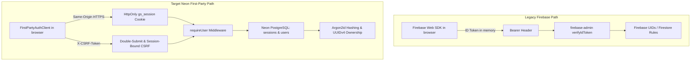
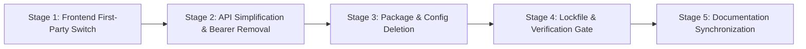

# Phase 4.9A: Full Firebase Retirement & Neon-Only Authentication Plan

**Document Status:** COMPLETE — READY FOR IMPLEMENTATION  
**Date of Plan:** 2026-10-23  
**Target Repository:** GrowSpace Monorepo (`C:\Real Project\GrowSpace`)  
**Verdict:** **`READY FOR IMPLEMENTATION`**

---

## Executive Summary

This document establishes the definitive, zero-downtime, safe execution plan for **Phase 4.9: Full Firebase Retirement**. 

GrowSpace is transitioning exclusively to:
1. **Neon PostgreSQL** as the single authoritative database.
2. **GrowSpace First-Party Authentication API** as the sole authentication provider (backed by Argon2id password hashing, server-managed opaque sessions, and secure `HttpOnly` / `__Host-` cookies).
3. **Fresh Start Account Model**: No legacy accounts, Firebase UIDs, or passwords require migration. All new accounts register directly through the GrowSpace first-party API.
4. **Complete Dependency Deletion**: Removal of `firebase`, `firebase-admin`, `firebase-tools`, `@firebase/util`, `firebase.json`, `.firebaserc`, and the `firebase/` rules directory.

An exhaustive repository scan identified **48 files** containing Firebase references, of which **14 require code refactoring**, **6 require deletion**, **3 require package/manifest updates**, and **5 require documentation/copy synchronization**.

---

## 1. Complete Firebase Dependency Inventory

Every Firebase reference across the workspace has been audited and mapped into one of six strict operational categories:

### 1.1 Web Application (`apps/web`)

| File Path | Description of Reference | Classification | Target Action in 4.9B |
|---|---|---|---|
| [`apps/web/src/lib/firebase.ts`](file:///C:/Real%20Project/GrowSpace/apps/web/src/lib/firebase.ts) | Web SDK initialization (`initializeApp`, `getAuth`, config). | **Dead code safe to remove** | Delete file after auth context is detached. |
| [`apps/web/src/features/auth/auth-config.ts`](file:///C:/Real%20Project/GrowSpace/apps/web/src/features/auth/auth-config.ts) | Provider resolution returning `'firebase'` or `'first_party'`. | **Compatibility code to remove** | Refactor to always return `'first_party'`. |
| [`apps/web/src/features/auth/auth-context.tsx`](file:///C:/Real%20Project/GrowSpace/apps/web/src/features/auth/auth-context.tsx) | `firebase/auth` hooks, `onAuthStateChanged`, Firebase error codes. | **Auth to replace with first-party** | Refactor to use `firstPartyAuthClient` exclusively. Remove all `firebase/auth` imports. |
| [`apps/web/src/lib/api.ts`](file:///C:/Real%20Project/GrowSpace/apps/web/src/lib/api.ts) | Attaches `Authorization: Bearer <token>` from `auth.currentUser`. | **Auth to replace with first-party** | Remove Bearer token injection. Make cookie credentials and CSRF tokens universal. |
| [`apps/web/src/features/auth/protected-route.tsx`](file:///C:/Real%20Project/GrowSpace/apps/web/src/features/auth/protected-route.tsx) | `status === 'unconfigured'` "Firebase configuration needed" banner. | **Dead code safe to remove** | Remove `'unconfigured'` branch and banner. |
| [`apps/web/src/features/auth/types.ts`](file:///C:/Real%20Project/GrowSpace/apps/web/src/features/auth/types.ts) | `AuthProviderType = 'firebase' \| 'first_party'`, `uid?: string`. | **Compatibility code to remove** | Change type to `'first_party'`; maintain `uid` as an alias for `id` if needed. |
| [`apps/web/src/pages/auth/login-page.tsx`](file:///C:/Real%20Project/GrowSpace/apps/web/src/pages/auth/login-page.tsx) | `isFirebaseReady` check, disabled submit button, unconfigured banner. | **Dead code safe to remove** | Remove `isFirebaseReady` and unconfigured banner. |
| [`apps/web/src/pages/auth/register-page.tsx`](file:///C:/Real%20Project/GrowSpace/apps/web/src/pages/auth/register-page.tsx) | `isFirebaseReady` check, disabled submit button, unconfigured banner. | **Dead code safe to remove** | Remove `isFirebaseReady` and unconfigured banner. |
| [`apps/web/src/pages/auth/forgot-password-page.tsx`](file:///C:/Real%20Project/GrowSpace/apps/web/src/pages/auth/forgot-password-page.tsx) | `isFirebaseReady` check, disabled submit button, unconfigured banner. | **Dead code safe to remove** | Remove `isFirebaseReady` and unconfigured banner. |
| [`apps/web/src/pages/dashboard/dashboard-page.tsx`](file:///C:/Real%20Project/GrowSpace/apps/web/src/pages/dashboard/dashboard-page.tsx) | Copy: "Firebase sent a verification link to {user.email}". | **Documentation / UI copy update** | Update copy to "A verification link has been sent to {user.email}". |
| [`apps/web/src/pages/dashboard/feature-pages.tsx`](file:///C:/Real%20Project/GrowSpace/apps/web/src/pages/dashboard/feature-pages.tsx) | Copy: "Ownership enforced by the API and Firestore rules". | **Documentation / UI copy update** | Update copy to "Ownership enforced by PostgreSQL authorization checks". |
| [`apps/web/src/pages/dashboard/settings-page.tsx`](file:///C:/Real%20Project/GrowSpace/apps/web/src/pages/dashboard/settings-page.tsx) | Copy: "Signing out ends the Firebase session". | **Documentation / UI copy update** | Update copy to "Signing out ends your session". |
| [`apps/web/src/vite-env.d.ts`](file:///C:/Real%20Project/GrowSpace/apps/web/src/vite-env.d.ts) | `VITE_FIREBASE_*` interface declarations. | **Dead code safe to remove** | Remove Firebase env definitions. |
| [`apps/web/.env.example`](file:///C:/Real%20Project/GrowSpace/apps/web/.env.example) | `VITE_FIREBASE_*` template variables. | **Dead code safe to remove** | Remove Firebase variables from example template. |
| [`apps/web/package.json`](file:///C:/Real%20Project/GrowSpace/apps/web/package.json) | `"firebase": "^13.0.0"` dependency. | **Dead code safe to remove** | Remove package dependency. |

---

### 1.2 API Server (`apps/api`)

| File Path | Description of Reference | Classification | Target Action in 4.9B |
|---|---|---|---|
| [`apps/api/src/lib/firebase-admin.ts`](file:///C:/Real%20Project/GrowSpace/apps/api/src/lib/firebase-admin.ts) | `firebase-admin` app, auth, and firestore singletons. | **Dead code safe to remove** | Delete file after API auth resolver drops Bearer verification. |
| [`apps/api/src/lib/firestore.ts`](file:///C:/Real%20Project/GrowSpace/apps/api/src/lib/firestore.ts) | Firestore `Timestamp` converters, `readDoc`, `assertDocumentOwner`. | **Dead code safe to remove** | Delete file (no active routes import this). |
| [`apps/api/src/lib/auth.ts`](file:///C:/Real%20Project/GrowSpace/apps/api/src/lib/auth.ts) | `getFirebaseAuth`, `readBearerToken`, dual credential conflict checks. | **Auth to replace with first-party** | Refactor `requireUser` to validate first-party session cookies only. Reject Bearer tokens. |
| [`apps/api/src/lib/env.ts`](file:///C:/Real%20Project/GrowSpace/apps/api/src/lib/env.ts) | `FIREBASE_PROJECT_ID`, `FIREBASE_CLIENT_EMAIL`, `isFirebaseConfigured`. | **Dead code safe to remove** | Remove Firebase environment variable parsers. |
| [`apps/api/src/app/api/health/route.ts`](file:///C:/Real%20Project/GrowSpace/apps/api/src/app/api/health/route.ts) | `firebaseAdminConfigured: env.isFirebaseConfigured`. | **Dead code safe to remove** | Replace with `databaseConfigured: true`. |
| [`apps/api/scripts/seed-catalog.ts`](file:///C:/Real%20Project/GrowSpace/apps/api/scripts/seed-catalog.ts) | Seeds plant catalog to Firestore `db.collection('plantCatalog')`. | **Database access to replace with Neon** | Replace with PostgreSQL idempotent catalog seeder. |
| [`apps/api/.env.example`](file:///C:/Real%20Project/GrowSpace/apps/api/.env.example) | `FIREBASE_PROJECT_ID`, `FIREBASE_PRIVATE_KEY`, emulators. | **Dead code safe to remove** | Remove Firebase variables from example template. |
| [`apps/api/package.json`](file:///C:/Real%20Project/GrowSpace/apps/api/package.json) | `"firebase-admin": "^14.5.0"` dependency. | **Dead code safe to remove** | Remove package dependency. |
| [`apps/api/src/app/api/dual-auth.test.ts`](file:///C:/Real%20Project/GrowSpace/apps/api/src/app/api/dual-auth.test.ts) | Tests for Firebase Bearer tokens, dual auth, and conflict rejection. | **Compatibility code to remove** | Refactor to pure session authentication suite; assert Bearer tokens are rejected. |
| [`apps/api/src/app/api/auth/auth-routes.test.ts`](file:///C:/Real%20Project/GrowSpace/apps/api/src/app/api/auth/auth-routes.test.ts) | `Firebase Regression Verification` test suite. | **Dead code safe to remove** | Delete Firebase regression test suite block. |

---

### 1.3 Project Configuration & Root (`GrowSpace`)

| File Path | Description of Reference | Classification | Target Action in 4.9B |
|---|---|---|---|
| [`firebase.json`](file:///C:/Real%20Project/GrowSpace/firebase.json) | Emulator ports and Firestore rules pointers. | **Dead code safe to remove** | Delete file. |
| [`.firebaserc`](file:///C:/Real%20Project/GrowSpace/.firebaserc) | Firebase project name mapping. | **Dead code safe to remove** | Delete file. |
| [`firebase/firestore.rules`](file:///C:/Real%20Project/GrowSpace/firebase/firestore.rules) | Firestore collection security rules. | **Dead code safe to remove** | Delete file and `firebase/` directory. |
| [`firebase/firestore.indexes.json`](file:///C:/Real%20Project/GrowSpace/firebase/firestore.indexes.json) | Firestore composite index definitions. | **Dead code safe to remove** | Delete file. |
| [`pnpm-workspace.yaml`](file:///C:/Real%20Project/GrowSpace/pnpm-workspace.yaml) | `allowBuilds: '@firebase/util': true`. | **Dead code safe to remove** | Remove `@firebase/util` build allowance. |
| [`package.json`](file:///C:/Real%20Project/GrowSpace/package.json) | `"emulators"` script and `"firebase-tools"` devDependency. | **Dead code safe to remove** | Remove script and package dependency. |
| [`.env`](file:///C:/Real%20Project/GrowSpace/.env) | `NEXT_PUBLIC_FIREBASE_*` dummy credentials. | **Dead code safe to remove** | Remove Firebase entries from `.env`. |
| [`.gitignore`](file:///C:/Real%20Project/GrowSpace/.gitignore) | `.firebase/`, `*firebase*.log`, `serviceAccount*.json`. | **Dead code safe to remove / retain** | Clean up obsolete rules while retaining generic `.log` and credential shields. |

---

## 2. Neon Readiness & Migration Status

### 2.1 Database Readiness Inspection (Read-Only)
- **Database Driver:** `@neondatabase/serverless` is already configured in `apps/api/src/lib/db.ts` and `apps/api/src/lib/auth/db-client.ts`.
- **Connection Strings in `.env`:**
  - `DATABASE_URL` (Pooled): Verified present.
  - `DATABASE_URL_UNPOOLED` (Direct): Verified present.
  - `NEON_BRANCH`: Configured to `production`.
- **Authentication Schema Readiness:**
  - The PostgreSQL schema defined in [`migrations/0001_create_auth_tables.sql`](file:///C:/Real%20Project/GrowSpace/migrations/0001_create_auth_tables.sql) provides all required tables: `users`, `sessions`, `auth_tokens`, and `auth_rate_limits`.
  - In integration tests ([`real-db-integration.test.mjs`](file:///C:/Real%20Project/GrowSpace/scripts/test/real-db-integration.test.mjs)), all 4 migration files apply cleanly to fresh PostgreSQL 17 instances, creating 11 application tables + `_schema_migrations` with 100% schema parity.
- **Remote Neon Migration Status:**
  - Remote migrations have been dry-run on isolated branches (`br-patient-cherry-a1y5jd7w`).
  - Running migrations on the active production Neon branch is designated for the Phase 10 deployment gate using [`scripts/run-migration.mjs`](file:///C:/Real%20Project/GrowSpace/scripts/run-migration.mjs).
- **Email Delivery Provider Readiness:**
  - The production mailer [`ResendAuthMailer`](file:///C:/Real%20Project/GrowSpace/apps/api/src/lib/auth/mailer.ts#L18-L107) requires `EMAIL_PROVIDER_API_KEY` (or `RESEND_API_KEY`).
  - In local development and testing, [`MockAuthMailer`](file:///C:/Real%20Project/GrowSpace/apps/api/src/lib/auth/mailer.ts#L113-L178) activates automatically when the key is omitted.
  - For live email delivery in staging/production, `EMAIL_PROVIDER_API_KEY` must be provisioned in secrets management.

---

## 3. Replacement Plan for Active Firebase Features

### 3.1 Authentication & Session State
- **Current:** Dual auth resolver accepting either Firebase Bearer ID tokens or First-Party Session cookies.
- **Target:** Single resolver [`requireUser`](file:///C:/Real%20Project/GrowSpace/apps/api/src/lib/auth.ts).
  - Validates `gs_session` (or `__Host-gs_session`) cookie against Neon `sessions` table.
  - If missing, invalid, expired, or idle-timed-out (>24h), fails closed with 401 `unauthenticated`.
  - Rejects Bearer tokens with 401 `unauthenticated` ("Bearer token authentication has been retired. Please sign in with your credentials.").
- **Client Auth State:**
  - `AuthProvider` in [`auth-context.tsx`](file:///C:/Real%20Project/GrowSpace/apps/web/src/features/auth/auth-context.tsx) calls [`firstPartyAuthClient.getSession()`](file:///C:/Real%20Project/GrowSpace/apps/web/src/features/auth/first-party-client.ts#L80-L98) on mount and listens for `session-expired` custom events.
  - Zero background polling; zero Firebase listeners.

### 3.2 User Registration & Verification
- **Current:** Firebase `createUserWithEmailAndPassword` + `sendEmailVerification` fallback.
- **Target:** `POST /api/auth/register` (Argon2id hashing, timing attack mitigation, 24-hour verification token digest stored in `auth_tokens`). Email delivered via Resend API / Mock Mailer. Account verified via `POST /api/auth/verify-email`.

### 3.3 Password Recovery
- **Current:** Firebase `sendPasswordResetEmail`.
- **Target:** `POST /api/auth/forgot-password` (opaque single-use token in URL fragment `#token=...`, 30-minute expiry) + `POST /api/auth/reset-password` (atomic CTE invalidating all active user sessions and updating password hash).

### 3.4 Resource Ownership
- **Current:** Checked against either `user.uid` (Firebase string) or `user.id` (UUID).
- **Target:** Enforces `resourceUserId === user.id` exclusively. All domain tables in PostgreSQL use `user_id UUID NOT NULL REFERENCES users(id) ON DELETE CASCADE`.

---

## 4. Safe Implementation Order (Phase 4.9B Execution)

To guarantee that the user experience is never broken during transition, changes must proceed in strictly linear, verified stages:

### Stage 1: Frontend Transition to Pure First-Party Auth
1. **`apps/web/src/features/auth/auth-config.ts`**: Set `getAuthProvider()` to return `'first_party'` unconditionally.
2. **`apps/web/src/features/auth/auth-context.tsx`**:
   - Remove `firebase/auth` imports and `authInstance`.
   - Remove `useEffect` subscribing to `onAuthStateChanged`.
   - Rewire `signIn`, `register`, `signOutUser`, and `resetPassword` to call `firstPartyAuthClient` directly.
   - Remove Firebase error code mapping block; preserve first-party mapping.
3. **`apps/web/src/lib/api.ts`**:
   - Remove `import { auth } from './firebase'`.
   - Remove Bearer token injection logic (`auth.currentUser.getIdToken()`).
   - Enable CSRF token attachment unconditionally for mutating calls.
4. **`apps/web/src/pages/auth/`**:
   - Remove `isFirebaseReady` props, checks, and unconfigured banners in `login-page.tsx`, `register-page.tsx`, and `forgot-password-page.tsx`.
5. **`apps/web/src/pages/dashboard/`**:
   - Update UI text in `dashboard-page.tsx`, `feature-pages.tsx`, and `settings-page.tsx`.
6. **`apps/web/src/features/auth/protected-route.tsx`**:
   - Remove the `status === 'unconfigured'` Firebase banner.
7. **Delete `apps/web/src/lib/firebase.ts`**.
8. **Verification Gate 1**: Run `pnpm --filter @growspace/web test`, `typecheck`, and `build`.

### Stage 2: API Server Transition to Pure Session Auth
1. **`apps/api/src/lib/auth.ts`**:
   - Remove `import { getFirebaseAuth } from './firebase-admin'`.
   - Remove `readBearerToken` and all Firebase token verification branches (Cases 1 & 3).
   - Ensure `requireUser` validates session cookies exclusively.
   - Simplify `AuthenticatedUser` to remove `authProvider: 'firebase'`.
   - Update `assertOwnership` to strictly check `resourceUserId === user.id`.
2. **`apps/api/src/app/api/health/route.ts`**:
   - Replace `firebaseAdminConfigured: env.isFirebaseConfigured` with `databaseConfigured: true`.
3. **`apps/api/src/lib/env.ts`**:
   - Remove `firebaseProjectId`, `firebaseClientEmail`, `firebasePrivateKey`, `isFirebaseConfigured`, `isEmulator`.
4. **Delete Dead Code Files**:
   - Delete `apps/api/src/lib/firebase-admin.ts`.
   - Delete `apps/api/src/lib/firestore.ts`.
5. **Catalog Seeder**:
   - Replace `apps/api/scripts/seed-catalog.ts` with a PostgreSQL-native catalog seed script or retire in favor of `0002_create_catalog_tables.sql`.
6. **Tests**:
   - Refactor `apps/api/src/app/api/dual-auth.test.ts` into a pure session test suite ([`session-auth.test.ts`](file:///C:/Real%20Project/GrowSpace/apps/api/src/app/api/auth/auth-routes.test.ts)); add a test verifying that Bearer tokens are rejected.
   - Delete the `Firebase Regression Verification` block from `apps/api/src/app/api/auth/auth-routes.test.ts`.
7. **Verification Gate 2**: Run `pnpm --filter @growspace/api test`, `typecheck`, and `build`.

### Stage 3: Dependency & File Cleanup
1. **`apps/web/package.json`**: Remove `"firebase": "^13.0.0"`.
2. **`apps/api/package.json`**: Remove `"firebase-admin": "^14.5.0"`.
3. **Root `package.json`**: Remove `"firebase-tools": "^15.34.0"` from `devDependencies` and remove `"emulators"` script.
4. **`pnpm-workspace.yaml`**: Remove `allowBuilds: '@firebase/util': true`.
5. **Delete Files & Directories**:
   - Delete `firebase.json`
   - Delete `.firebaserc`
   - Delete `firebase/firestore.rules`
   - Delete `firebase/firestore.indexes.json`
   - Remove `firebase/` directory
6. **Clean `.env.example` templates**:
   - Remove `VITE_FIREBASE_*` from `apps/web/.env.example`.
   - Remove `FIREBASE_*` from `apps/api/.env.example`.
7. **Clean Root `.env`**:
   - Remove `NEXT_PUBLIC_FIREBASE_*` dummy variables.

### Stage 4: Package Installation & Monorepo Verification Gate
1. Run `pnpm install` to purge Firebase packages from `node_modules` and update `pnpm-lock.yaml`.
2. Execute full monorepo quality suite:
   - `pnpm test` (all workspace tests + runner tests).
   - `pnpm typecheck` (all packages).
   - `pnpm lint` (`eslint .`).
   - `pnpm build` (Next.js Turbopack and Vite client production builds).
3. Verify zero unresolved Firebase imports across the entire repository.

### Stage 5: Documentation Synchronization
1. Update `docs/implementation-status.md`, `docs/stack-mapping.md`, `docs/auth/architecture.md`, `docs/auth/firebase-exit-plan.md`, and `README.md` to reflect complete Firebase retirement.

---

## 5. Testing & Verification Strategy

| Check | Target / Success Criteria | Verification Command |
|---|---|---|
| **Web Client Tests** | All 13 first-party client tests pass without Firebase mocks. | `pnpm --filter @growspace/web test` |
| **API Auth Tests** | All session, registration, login, logout, verification, and reset tests pass. | `pnpm --filter @growspace/api test` |
| **Shared Package** | All 23 schema and rule engine tests pass. | `pnpm --filter @growspace/shared test` |
| **TypeScript Integrity** | Zero type errors across web, api, and shared. | `pnpm typecheck` |
| **Code Style & Linting** | Clean linting with zero unused import warnings. | `pnpm lint` |
| **Production Builds** | Next.js API build and Vite SPA build succeed in production mode. | `pnpm build` |
| **Zero Import Audit** | Zero occurrences of `from 'firebase...'` or `from 'firebase-admin...'`. | Regex scan across `apps/` and `packages/` |

---

## 6. Risks, Blockers, and Mitigation Matrix

| Risk / Potential Issue | Severity | Mitigation Strategy |
|---|:---:|---|
| **Accidental UI Breakage** | Medium | The first-party client (`firstPartyAuthClient`) is already fully implemented and verified with 13 tests. The UI will swap cleanly from Firebase to first-party calls. |
| **Bearer Token Client Requests** | Low | GrowSpace has no external API consumers or mobile clients. The SPA is the only consumer and will switch to cookie-based sessions. |
| **Missing Production Email Key** | Low | `MockAuthMailer` handles local development and testing gracefully without external network calls. Production requires `EMAIL_PROVIDER_API_KEY`. |
| **Unversioned Source Changes** | High | Git baseline initialization will be completed immediately following the retirement verification gate. |

---

## 7. Final Verdict

### **`READY FOR IMPLEMENTATION`**

The dependency mapping is comprehensive, all replacement mechanisms are pre-implemented and tested, zero application data depends on Firestore, and a safe 5-stage execution order is established.

**Next Recommended Action:** Proceed with **Phase 4.9B: Execution of Stage 1 (Frontend Transition to Pure First-Party Auth)** upon explicit user instruction.
