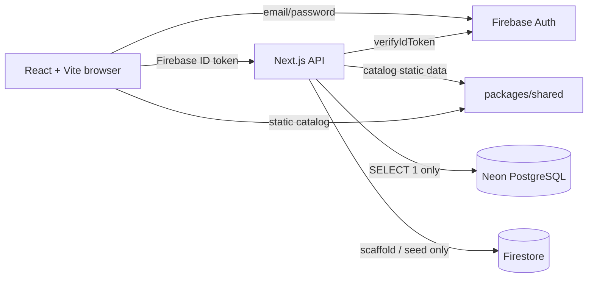

# Data and Firebase Dependency Discovery — GrowSpace

Last updated: 2026-10-20

Status: Phase 3A discovery and design input. No PostgreSQL schema, migration, Firebase change, authentication implementation, or production data query has been executed. This document records the current repository state and the dependency inventory required for a full Firebase exit.

## 1. Purpose

This discovery answers:

1. Which Firebase and Firestore dependencies exist, including indirect runtime paths?
2. Which data is actually persisted today?
3. Which user-owned entities need PostgreSQL ownership rules?
4. Which authentication behavior must be rebuilt without Firebase?
5. What can and cannot be migrated from Firebase?

The target end state is a Vite/React web app and Next.js API using Neon PostgreSQL for application data and server-managed, opaque database sessions for authentication. Firebase is removed only after the replacement passes verification.

## 2. Repository reality and audit scope

The task description refers to Next.js web and API applications. The actual repository is:

- `apps/web`: React 19 + Vite 8 SPA, React Router 7.
- `apps/api`: Next.js 16 App Router API only.
- `packages/shared`: types, Zod schemas, static catalog, recommendations.
- Neon PostgreSQL connectivity is implemented and `pnpm db:check` passes.
- No Next.js web application exists. Auth replacement must therefore work with the Vite SPA and the API's cookie/CORS model.

Audited areas:

- Source imports and runtime flows under `apps/` and `packages/`.
- Package manifests and workspace build configuration.
- Firebase configuration, rules, indexes, seed scripts, and emulator setup.
- Environment templates (`.env.example` only; real `.env` values were not read or printed).
- README, product docs, and implementation/status docs.
- Deployment surface. No Docker, Vercel, Netlify, Fly, Railway, or serverless deployment config was found in the repository.

## 3. Current runtime architecture



Confirmed facts:

- Firebase Authentication is the live client auth system when Firebase web env values are configured.
- The web app observes Firebase auth state through `onAuthStateChanged`.
- The API verifies Firebase bearer tokens with Firebase Admin and checks revocation.
- `/api/me` returns the verified Firebase identity. It does not read a database.
- `/api/catalog` and `/api/catalog/[slug]` read the static shared catalog.
- Firestore Admin helpers and rules/indexes exist, but no private CRUD route uses Firestore.
- The catalog seed script writes to Firestore, not Neon.
- No `sessions`, `users`, password, email-verification, or password-reset table exists.
- No user-owned data API route exists yet, so there is no runtime PostgreSQL/Firestore write path for gardens, plants, readings, tasks, or logs.

## 4. Firebase dependency inventory

### 4.1 Package dependencies

| Package | Location | Type | Current purpose | Exit requirement |
| --- | --- | --- | --- | --- |
| `firebase` `^13.0.0` | `apps/web/package.json` | Runtime | Firebase app/auth client, `onAuthStateChanged`, registration, login, logout, reset | Remove after web auth uses API sessions |
| `firebase-admin` `^14.5.0` | `apps/api/package.json` | Runtime | Verify ID tokens; initialize Firestore; catalog seed | Remove after session auth and Postgres catalog seed replace all callers |
| `firebase-tools` `^15.34.0` | root `package.json` | Dev | Emulator CLI | Remove with emulator scripts after exit |
| `@firebase/util` allowBuild | `pnpm-workspace.yaml` | Build config | Permits Firebase native build step | Remove after dependency removal |
| Firebase transitive packages | `pnpm-lock.yaml` | Transitive | Pulled by the three direct dependencies | Regenerate lockfile after direct dependency removal |

No password hashing, session, cookie, JWT, CSRF, or alternate auth framework is currently a direct dependency. Authentication must be designed before implementation; this phase must not add packages.

### 4.2 Web runtime and UI

| File | Current behavior | Replacement needed |
| --- | --- | --- |
| `apps/web/src/lib/firebase.ts` | Initializes Firebase app/auth from `VITE_FIREBASE_*`; exports `auth`, `firebaseApp`, `isFirebaseConfigured` | Delete; no Firebase client SDK |
| `apps/web/src/features/auth/auth-context.tsx` | Firebase registration, login, reset, logout, `onAuthStateChanged`, Firebase error-code mapping | Rewrite as API-backed auth provider using `GET /api/auth/session`, credential fetches, cookie state, CSRF |
| `apps/web/src/lib/api.ts` | Adds `Authorization: Bearer <Firebase ID token>` to every fetch | Remove token injection; send `credentials: 'include'` plus CSRF header on unsafe methods |
| `apps/web/src/features/auth/protected-route.tsx` | Checks Firebase auth status; shows Firebase configuration error | Rewrite for API session status; no Firebase configuration concept |
| `apps/web/src/pages/auth/login-page.tsx` | Calls Firebase `signInWithEmailAndPassword` through context; Firebase readiness copy | Call API login; remove Firebase checks and error mapping |
| `apps/web/src/pages/auth/register-page.tsx` | Creates Firebase user, updates display name, sends Firebase verification email | Call API registration; server hashes password and sends verification email |
| `apps/web/src/pages/auth/forgot-password-page.tsx` | Calls Firebase password reset email | Call API forgot-password endpoint; generic response |
| `apps/web/src/pages/dashboard/dashboard-page.tsx` | Displays Firebase-specific email-verification copy | Use API user/email-verification state |
| `apps/web/src/pages/dashboard/settings-page.tsx` | Reads Firebase `user`; says signing out ends Firebase session | Use API user; signing out revokes server session |
| `apps/web/src/pages/dashboard/feature-pages.tsx` | Placeholder says “Ownership enforced by the API and Firestore rules” | Update copy after Firestore removal; not runtime logic |
| `apps/web/src/pages/public/plant-detail-page.tsx` | Uses auth status to choose “Add to My Garden” target | Keep behavior with API-backed auth status |
| `apps/web/src/main.tsx` | Wraps app in `AuthProvider` | Keep provider name/position; replace implementation |
| `apps/web/src/vite-env.d.ts` | Declares `VITE_FIREBASE_*` env types | Remove Firebase variables; add API/CSRF if needed |
| `apps/web/.env.example` | Firebase web identifiers | Replace with public API base/proxy variables only |
| `apps/web/src/components/layout/dashboard-layout.tsx` | Uses `user.displayName`, `user.email`, `signOutUser` | Compatible API user shape; logout must revoke session |
| `apps/web/src/components/layout/auth-layout.tsx` | Layout only | Confirm no hidden Firebase dependency; none found |

Indirect runtime flow:

```text
main.tsx
  -> AuthProvider (auth-context.tsx)
     -> lib/firebase.ts
        -> firebase/app, firebase/auth

api.ts -> lib/firebase.ts
protected-route.tsx -> auth-context.tsx
login/register/forgot-password/dashboard/settings/plant-detail
  -> auth-context.tsx
```

Removing only `lib/firebase.ts` without rewriting `auth-context.tsx` and `api.ts` would break auth state, login, route protection, and all API calls.

### 4.3 API runtime

| File | Current behavior | Replacement needed |
| --- | --- | --- |
| `apps/api/src/lib/firebase-admin.ts` | Initializes Firebase Admin from service account, ADC, or emulator; exports Auth and Firestore | Delete; replace with PostgreSQL user/session repository |
| `apps/api/src/lib/auth.ts` | Reads bearer token, verifies Firebase ID token, returns UID/email/name/verified; `assertOwnership` | Rewrite as session validator; internal user UUID; ownership helpers |
| `apps/api/src/lib/firestore.ts` | Firestore timestamp conversion, document reading, ownership assertion | Delete or replace with SQL row mappers; currently imported by no route |
| `apps/api/src/lib/env.ts` | Firebase project/client/private key config, emulator detection, CORS origins, database URL | Remove Firebase fields/emulator detection; add session/email/rate-limit/security config |
| `apps/api/src/app/api/me/route.ts` | Returns Firebase identity | Replace with `GET /api/auth/session` or return internal session user |
| `apps/api/src/app/api/health/route.ts` | Returns `firebaseAdminConfigured` | Remove Firebase field; report safe service health only |
| `apps/api/src/proxy.ts` | CORS allowlist, credentials, `Authorization` allowed header, security headers | Remove Firebase bearer auth support; add cookie-aware CORS/origin/CSRF handling if needed |
| `apps/api/next.config.ts` | `serverExternalPackages: ['firebase-admin']` | Remove entry |
| `apps/api/scripts/seed-catalog.ts` | Writes static catalog to Firestore with Firebase Timestamp | Rewrite to idempotent Neon seed; keep static catalog until verified |
| `apps/api/src/lib/env.test.ts` | Tests database URL validation only | Keep; add auth/session/security config tests later |
| `apps/api/src/app/api/catalog/route.ts` | Static catalog; no Firebase | No Firebase change; later optional DB read |
| `apps/api/src/app/api/catalog/[slug]/route.ts` | Static catalog; no Firebase | No Firebase change; later optional DB read |

There is no `middleware.ts`; the Next 16 request hook is `apps/api/src/proxy.ts`. There are no Next server components or server actions. Auth enforcement currently occurs only in `/api/me`; future private route handlers must enforce sessions themselves.

### 4.4 Configuration, scripts, and environment

| Item | Current state | Replacement needed |
| --- | --- | --- |
| Root `emulators` script | `firebase emulators:start` | Remove after Firebase exit |
| Root `seed:catalog` script | Calls Firestore seed | Point to Postgres seed |
| `firebase.json` | Firestore rules/indexes, Auth/Firestore emulators, UI on 4000 | Delete after exit |
| `.firebaserc` | Default project `growspace-demo` (not a secret) | Delete after exit |
| `firebase/firestore.rules` | Ownership and field validation rules for planned collections | Archive until removal; not a runtime replacement |
| `firebase/firestore.indexes.json` | Planned Firestore composite indexes | Archive until removal; translate query intent into SQL indexes |
| `apps/web/.env.example` | `VITE_FIREBASE_*`, API base/proxy | Remove Firebase values |
| `apps/api/.env.example` | Firebase Admin values, ADC, emulators, origins, DB URL | Remove Firebase values; add auth/email/session/security variables |
| `.gitignore` | Ignores Firebase debug logs and service-account keys | Keep secret-protection intent; remove Firebase-specific entries only after exit |
| `pnpm-workspace.yaml` | Allows `@firebase/util` build | Remove after dependency removal |
| Real `.env` / local env files | Not inspected. May contain Firebase credentials and Neon URL | Do not copy or print; replace/rotate during implementation with explicit approval |

No Firebase Hosting, Cloud Functions, Cloud Storage, Cloud Messaging, Analytics, Remote Config, App Check, or Realtime Database configuration was found.

### 4.5 Data and documentation

| Item | Current state | Replacement needed |
| --- | --- | --- |
| Firebase Auth users | Managed by Firebase; no live project configured in this environment | Export/metadata migration or forced password reset |
| Firestore private collections | Rules/indexes exist; no runtime private CRUD; actual contents unknown | Read-only inventory before deciding migration |
| Firestore `plantCatalog` | Seed script target; static catalog remains API source | Seed `plant_catalog` in Neon |
| `README.md` | Describes Firebase Auth/Firestore stack and commands | Update after implementation |
| `docs/stack-mapping.md` | Documents Firebase/Firestore architecture | Superseded by this Firebase exit design; update during implementation |
| `docs/implementation-status.md` | Firebase auth marked partial; Firestore rules pending | Update after replacement verification |
| Product docs | Supabase/RLS assumptions | Adapt to Neon + server sessions; preserve product behavior |
| `.env.example` files | Firebase placeholders | Replace with server-auth placeholders |

## 5. Current data inventory

| Data | Current authority | Persisted today? | Target owner/storage |
| --- | --- | --- | --- |
| Authentication identity | Firebase Auth | Firebase-managed | `users` |
| Password credentials | Firebase Auth | Firebase-managed, not exposed to app | `users.password_hash` using Argon2id |
| Browser session | Firebase SDK | Firebase-managed | `sessions` + opaque HttpOnly cookie |
| Email verification state | Firebase Auth | Firebase-managed | `users.email_verified_at` + `auth_tokens` |
| Password reset state | Firebase Auth | Firebase-managed | `auth_tokens` purpose `password_reset` |
| Display name / temperature unit | Firebase metadata + local type | Display name in Firebase; unit not saved | `users.display_name`, `users.temperature_unit` |
| Garden | `Garden` type + Firestore rules | Not persisted by runtime code | `gardens.user_id → users.id` |
| Plant | `Plant` type + Firestore rules | Not persisted by runtime code | `plants.user_id → users.id` |
| Reading | `SensorReading` type + Firestore rules | Not persisted by runtime code | `sensor_readings.user_id → users.id` |
| Care task | `CareTask` type + Firestore rules | Not persisted by runtime code | `care_tasks.user_id → users.id` |
| Plant log | `PlantLog` type + Firestore rules | Not persisted by runtime code | `plant_logs.user_id → users.id` |
| Plant catalog | Static shared array, 12 entries | Source code; Firestore seed possible | `plant_catalog` + range rows |
| Recommendation | Derived pure function | In memory | No table; derived from readings + catalog |
| Enums, units, source labels | Shared constants | Source code | App validation + DB checks |
| Form state, filters | React state | Transient | Not persisted |

Domain fields and validation rules are unchanged from the earlier discovery: gardens, plants, readings, tasks, and logs retain their shared TypeScript/Zod contracts. The material change is that `userId` becomes an internal `users.id` UUID, not a Firebase UID.

## 6. Current authentication flows

### Registration

1. Web calls Firebase `createUserWithEmailAndPassword`.
2. Firebase creates the account.
3. Web optionally updates display name.
4. Web sends Firebase email verification.
5. Redirect to dashboard/return path.

There is no application database user, password hash, session row, or email token. Firebase owns all of it.

### Login

1. Web calls Firebase `signInWithEmailAndPassword`.
2. Firebase SDK persists and refreshes the client session.
3. `apiFetch` calls `getIdToken()` and adds a bearer header.
4. API verifies the token with revocation checks.

### Session restoration

- `onAuthStateChanged` resolves `loading → authenticated | unauthenticated`.
- The web app trusts Firebase's client session for route UX. API routes independently verify tokens.
- No server-managed session, cookie, CSRF token, or idle timeout exists.

### Logout

- Firebase `signOut()`. No server session to revoke.

### Password reset / email verification

- Both are delegated to Firebase email flows.
- The app does not control email templates, token expiry, reset token storage, or delivery provider.

### Authorization

- API has `requireUser()` and `assertOwnership()`, but only `/api/me` uses the auth helper.
- No private CRUD route exists. Firestore rules are a planned but untested alternative boundary.

## 7. What must be replaced

| Capability | Firebase mechanism | Required replacement |
| --- | --- | --- |
| User identity | Firebase UID | Internal UUID `users.id`; email unique |
| Password verification | Firebase Auth | Argon2id hash verification in the API |
| Browser session | Firebase SDK persistence | Opaque random token in HttpOnly cookie; SHA-256 token hash in `sessions` |
| Session restoration | `onAuthStateChanged` | `GET /api/auth/session` with cookie |
| Route protection | Firebase auth state | API session state; UI guard is UX only |
| API authentication | Bearer Firebase ID token | Cookie session validation in route handlers |
| Email verification | Firebase email action | `auth_tokens` purpose `email_verification` + transactional email provider |
| Password reset | Firebase email action | `auth_tokens` purpose `password_reset` + provider |
| Rate limiting | Firebase-managed | API/edge limits + DB-backed throttles |
| CSRF | Not applicable to bearer tokens | Origin checks + session-bound CSRF token |
| Catalog seed | Firestore Admin | Neon seed |
| Ownership | Firestore rules planned | Server-side checks + PostgreSQL composite FKs |
| Auth secrets | Firebase service account | Database role, rate-limit secret, email provider key; no Firebase keys |

## 8. Findings, risks, and constraints

1. **No existing auth replacement dependency is installed.** The implementation phase must evaluate and add a maintained password-hashing library. No new dependency is allowed in Phase 3A.
2. **No live Firebase project is configured in this environment.** Firebase auth end-to-end and Firestore rules were never verified. Existing Firebase users/data cannot be assumed.
3. **Passwords are not automatically portable.** Firebase CLI export can include modified-SCRYPT hashes for accounts hashed by Firebase's backend, but that is not Argon2id-compatible and requires sensitive project hash parameters. Imported accounts may have empty password hashes. Default planning must include forced password reset; optional legacy verification requires an explicit, time-limited migration design.
4. **Existing Firebase sessions cannot be transferred.** All users will need to establish a new server session after cutover.
5. **No email provider exists.** Verification and reset require an external transactional email service, verified sending domain, SPF/DKIM/DMARC, and bounce handling.
6. **Current cookie/CORS topology is not ready.** The API allows credentials and `Authorization`; the web uses bearer tokens. New auth needs first-party cookies and CSRF, preferably behind a same-origin `/api` reverse proxy.
7. **No production data migration may be assumed.** Firestore private collections likely have no runtime writes, but must be inventoried read-only before cutover.
8. **Firestore helper is unused.** `apps/api/src/lib/firestore.ts` imports Firebase Admin but has no route caller; it still counts as a source dependency and must be removed.
9. **Placeholder UI contains Firebase/Firestore copy.** It must be updated so the product does not claim a removed backend.
10. **No deployment configuration exists.** The same-origin cookie strategy and secret management must be documented before deployment.
11. **No password-change feature exists.** It is not assumed for this phase; password reset covers credential recovery. Add password change only as a separately approved feature.
12. **No MFA, social login, or account deletion exists.** Do not invent them for parity.

## 9. Assumptions and open decisions

Assumptions:

1. The Next.js API is the only PostgreSQL client.
2. The web app and API can be served on the same site, preferably via a same-origin `/api` proxy.
3. Neon remains the primary database.
4. Email/password is the only authentication method.
5. Firebase project data, if any, can be exported with authorized operator access.
6. Existing private data volume is small; no zero-downtime bulk migration is assumed.
7. The product will accept users needing to sign in again after cutover.

Open decisions:

1. Email verification required before login, before private writes, or optional.
2. Forced password reset only, or optional legacy Firebase SCRYPT verification with rehash.
3. Session defaults: absolute lifetime, idle timeout, and whether periodic rotation is required.
4. Transactional email provider and sending domain.
5. RLS as defence in depth versus API-only enforcement with least-privilege DB role.
6. Whether account deletion is added; if not, document the unresolved lifecycle without inventing it.
7. Whether self-service password change is added after the migration.
8. Whether Firestore private data exists and must be migrated.

## 10. Conclusion

Firebase is not a small helper dependency. It spans the web auth provider, API auth guard, API config, Firestore scaffolding, seed script, environment templates, package scripts, build configuration, and documentation. The replacement must introduce a real application identity model, password hashing, server-managed sessions, CSRF, rate limiting, email verification, password reset, and internal user IDs. The existing gardens/plants/readings/tasks/logs contracts can be preserved, but their ownership key must move from Firebase UID text to `users.id` UUID.

No Firebase code, dependencies, configuration, or data should be removed until the replacement auth and data paths pass the verification gates in `docs/auth/firebase-exit-plan.md`.
