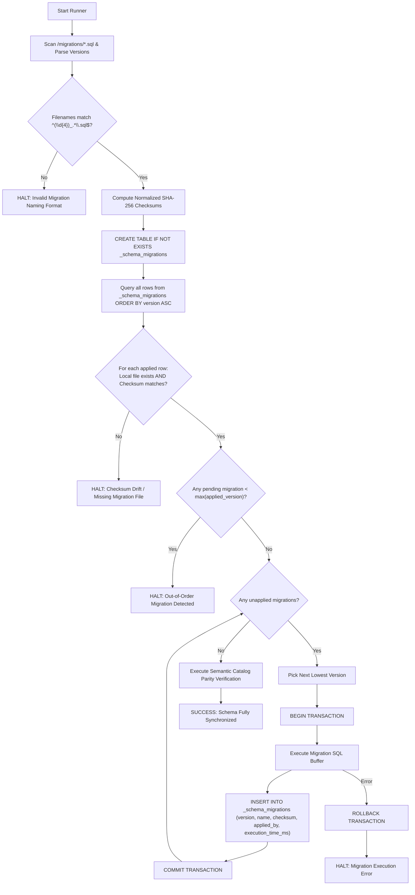
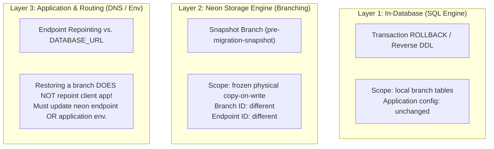
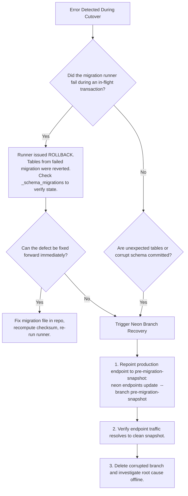

# Production Cutover Plan & Migration Runner Design — GrowSpace

Last updated: 2026-10-21  
Status: **Historical Phase 4 runbook (migrations 0001–0004).** For the current state of the
repository — migrations `0001`–`0008`, 16 application tables, and the pending `0007`/`0008`
production cutover — use [`cutover-0007-0008.md`](cutover-0007-0008.md) and
[`../deployment/production.md`](../deployment/production.md). The runner architecture, locking
protocol, and Neon recovery model below remain accurate; the table counts, migration counts, and
"production has no user tables" gate apply only to the Phase 4 baseline.  
Target Database: Neon PostgreSQL 15+ (Production Branch: `br-patient-cherry-a1y5jd7w`)

---

## 1. Executive Summary & Purpose

This document provides the definitive, reproducible engineering design for the **GrowSpace Phase 4 Production Cutover**. It synthesizes the empirical findings of the **Phase 3B.3 Neon dry-run** and the structural findings of the **Phase 3B.4 audit**.

The plan covers three mission-critical domains:
1. **Migration Runner Architecture**: A deterministic, drift-detecting, transaction-safe migration runner that manages `_schema_migrations`.
2. **Concurrency & Locking Specification**: An exhaustive locking protocol (`SELECT ... FOR UPDATE`) for auth token issuance in application runtime code.
3. **Operator Runbook & Recovery Matrix**: A step-by-step preflight, execution, validation, and disaster recovery procedure separating in-database rollback, Neon storage branching, and application endpoint cutover.

---

## 2. Migration Runner Architecture & Specification

### 2.1 Core Principles
The runner must strictly satisfy seven inviolable design rules:
1. **Ascending Numerical Order**: Migrations are executed in lexicographical/numerical order (`0001` -> `0002` -> `0003` -> `0004`).
2. **Deterministic Checksums**: SHA-256 hashes are computed over line-normalized file content (`\r\n` converted to `\n`) to guarantee cross-platform immutability.
3. **Drift Detection**: Any discrepancy between a recorded checksum in `_schema_migrations` and the local file immediately halts execution.
4. **Monotonic Progression**: Unapplied migrations with sequence numbers lower than the highest applied version (out-of-order files) immediately halt execution.
5. **Transactional Atomicity**: Each migration's DDL and its corresponding entry in `_schema_migrations` execute inside the **same database transaction**.
6. **Fail-Closed Semantics**: Any unexpected error, unknown version format, missing file, or partial state immediately triggers `ROLLBACK` and process exit `1`.
7. **Semantic Validation over Syntactic Idempotency**: The runner never assumes `CREATE TABLE IF NOT EXISTS` proves schema equivalence; an explicit catalog inspection query validates the resulting schema against the target specification.

---

### 2.2 Schema History Table: `_schema_migrations`

The runner bootstraps the history table if it does not already exist:

```sql
CREATE TABLE IF NOT EXISTS _schema_migrations (
    version TEXT PRIMARY KEY,               -- Numerical prefix (e.g. '0001')
    name TEXT NOT NULL,                    -- File basename (e.g. '0001_create_auth_tables.sql')
    checksum VARCHAR(64) NOT NULL,         -- SHA-256 hex digest of normalized content
    applied_by TEXT NOT NULL,              -- Database user (current_user)
    execution_time_ms INTEGER NOT NULL,    -- Execution duration in ms
    applied_at TIMESTAMPTZ NOT NULL DEFAULT now()
);

COMMENT ON TABLE _schema_migrations IS 'Authoritative ledger of applied schema migrations and integrity checksums';
```

---

### 2.3 Migration Runner Logic & State Machine



---

### 2.4 Implemented Migration Runner & Architecture

The migration runner is implemented in the repository across two dedicated scripts:
- **Core Runner Engine**: [scripts/lib/migration-runner.mjs](file:///c:/Real%20Project/GrowSpace/scripts/lib/migration-runner.mjs) (supports dependency injection for filesystem, client, and logger).
- **Executable CLI Runner**: [scripts/run-migration.mjs](file:///c:/Real%20Project/GrowSpace/scripts/run-migration.mjs) (handles branch resolution, connection strings, masked logging, advisory locking, and automated postflight validation).
- **Automated Test Suite**: [scripts/test/migration-runner.test.mjs](file:///c:/Real%20Project/GrowSpace/scripts/test/migration-runner.test.mjs) (verifies all 10 unit and integration invariants).

The runner interacts with Neon PostgreSQL using strict transactional boundaries and advisory locks:

```typescript
import { readFileSync, readdirSync } from 'node:fs';
import { createHash } from 'node:crypto';
import { join, basename } from 'node:path';
import { Client } from '@neondatabase/serverless';

export interface MigrationFile {
  version: string;
  name: string;
  fullPath: string;
  checksum: string;
  sql: string;
}

export function computeNormalizedChecksum(rawContent: string): string {
  // Normalize Windows CRLF to standard Unix LF for deterministic cross-platform hashes
  const normalized = rawContent.replace(/\r\n/g, '\n');
  return createHash('sha256').update(normalized, 'utf8').digest('hex');
}

export function loadAndValidateMigrations(migrationsDir: string): MigrationFile[] {
  const files = readdirSync(migrationsDir)
    .filter((f) => f.endsWith('.sql'))
    .sort();

  const migrations: MigrationFile[] = [];
  const versionSet = new Set<string>();

  for (const file of files) {
    const match = file.match(/^(\d{4})_(.+)\.sql$/);
    if (!match) {
      throw new Error(`Invalid migration filename format: "${file}". Must match "0000_name.sql"`);
    }
    const version = match[1];
    if (versionSet.has(version)) {
      throw new Error(`Duplicate migration version detected: "${version}" in file "${file}"`);
    }
    versionSet.add(version);

    const fullPath = join(migrationsDir, file);
    const sql = readFileSync(fullPath, 'utf8');
    const checksum = computeNormalizedChecksum(sql);

    migrations.push({
      version,
      name: file,
      fullPath,
      checksum,
      sql,
    });
  }

  return migrations;
}

export async function runMigrations(client: Client, migrationsDir: string): Promise<void> {
  const localMigrations = loadAndValidateMigrations(migrationsDir);

  // 1. Ensure history table exists
  await client.query(`
    CREATE TABLE IF NOT EXISTS _schema_migrations (
      version TEXT PRIMARY KEY,
      name TEXT NOT NULL,
      checksum VARCHAR(64) NOT NULL,
      applied_by TEXT NOT NULL,
      execution_time_ms INTEGER NOT NULL,
      applied_at TIMESTAMPTZ NOT NULL DEFAULT now()
    );
  `);

  // 2. Fetch applied migration ledger
  const historyRes = await client.query<{
    version: string;
    name: string;
    checksum: string;
  }>(`SELECT version, name, checksum FROM _schema_migrations ORDER BY version ASC;`);
  
  const appliedMap = new Map(historyRes.rows.map((r) => [r.version, r]));
  const maxAppliedVersion = historyRes.rows.length > 0 
    ? historyRes.rows[historyRes.rows.length - 1].version 
    : null;

  // 3. Verify checksums of applied migrations (Drift Check)
  for (const applied of historyRes.rows) {
    const local = localMigrations.find((m) => m.version === applied.version);
    if (!local) {
      throw new Error(
        `CRITICAL DRIFT: Previously applied migration "${applied.version}" (${applied.name}) is missing from repository!`
      );
    }
    if (local.checksum !== applied.checksum) {
      throw new Error(
        `CRITICAL CHECKSUM DRIFT: Migration "${applied.version}" (${applied.name}) has been modified!\n` +
        `  Recorded in DB : ${applied.checksum}\n` +
        `  Local working  : ${local.checksum}\n` +
        `Migrations must be immutable. Create a new forward migration instead.`
      );
    }
  }

  // 4. Identify pending migrations & verify monotonic ordering
  const pending: MigrationFile[] = [];
  for (const local of localMigrations) {
    if (!appliedMap.has(local.version)) {
      if (maxAppliedVersion && local.version < maxAppliedVersion) {
        throw new Error(
          `OUT-OF-ORDER MIGRATION: Migration "${local.version}" (${local.name}) has not been applied, ` +
          `but a newer migration "${maxAppliedVersion}" has already executed. Halting.`
        );
      }
      pending.push(local);
    }
  }

  if (pending.length === 0) {
    console.log('Database is up to date. No pending migrations.');
    return;
  }

  console.log(`Discovered ${pending.length} pending migration(s). Executing in transaction...`);

  // 5. Execute each pending migration in its own atomic transaction
  for (const migration of pending) {
    console.log(`Applying migration ${migration.version}: ${migration.name}...`);
    const startTime = Date.now();

    try {
      await client.query('BEGIN');
      
      // Execute the migration DDL
      await client.query(migration.sql);

      // Record in history ledger
      const durationMs = Date.now() - startTime;
      await client.query(
        `INSERT INTO _schema_migrations (version, name, checksum, applied_by, execution_time_ms)
         VALUES ($1, $2, $3, current_user, $4);`,
        [migration.version, migration.name, migration.checksum, durationMs]
      );

      await client.query('COMMIT');
      console.log(`  ✓ Successfully applied ${migration.name} in ${durationMs}ms`);
    } catch (err) {
      await client.query('ROLLBACK');
      console.error(`  ✗ FAILED to apply ${migration.name}. Transaction rolled back.`);
      throw err;
    }
  }
}
```

---

## 3. Transaction Strategy Evaluation & Decision

### 3.1 Comparative Analysis

| Evaluation Metric | Option A: Single Mega-Transaction (`0001`–`0004` in one TX) | Option B: One Transaction Per Migration File (Selected) |
| :--- | :--- | :--- |
| **Day-1 Greenfield Atomicity** | **All-or-Nothing**: Any failure leaves DB at exactly 0 tables. | **Segmented**: Failure at `0003` leaves `0001` & `0002` committed. |
| **History Ledger Alignment** | Awkward: commits 4 history records at the very end. | **Native**: Each file atomically writes its own record. |
| **Incremental Scalability** | Fails: cannot be used for future migrations (`0005`, `0006`). | **Optimal**: Same runner used for initial cutover and day-2 operations. |
| **Failure Diagnosis** | Obscures partial success; entire transaction is unwound. | **Precise**: Pinpoints exact file and statement failure boundary. |
| **Disaster Recovery Safety** | Relies entirely on database engine rollback. | Backed by **Neon Point-in-Time Branch Snapshots**. |

### 3.2 Chosen Approach: One Transaction Per Migration File
**Decision**: Adopt **Option B (One Transaction Per Migration File)**.

**Justification**:
1. **Architectural Uniformity**: A production migration runner must be built for the entire software lifecycle. Special-casing initial cutover as a monolithic script creates two divergent code paths and testing burdens.
2. **Deterministic Ledger State**: If migration `0003` fails, `_schema_migrations` accurately indicates that `0001` and `0002` are committed and valid. The drift-detection engine ensures that re-running the runner after fixing `0003` safely resumes from `0003` without re-running or skipping.
3. **Neon Snapshots Eliminate Partial-State Risks**: Because an instantaneous copy-on-write snapshot branch (`pre-migration-snapshot`) is created before the run, the operator does not depend on database transaction rollback for disaster recovery. If a hard failure occurs during `0003`, the operator can either fix forward or reset the branch to the snapshot in seconds.

---

## 4. Token Issuance Concurrency & Locking Specification

### 4.1 Vulnerability Recap
In `migrations/0001_create_auth_tables.sql`, the index `auth_tokens_user_purpose_active_idx` is defined as a non-unique partial index on `(user_id, purpose) WHERE consumed_at IS NULL`.  
Under standard `READ COMMITTED` isolation, concurrent issuance requests (e.g. double-clicking "Resend Verification" or racing password-reset requests) when no active token exists can both run `UPDATE auth_tokens ... WHERE consumed_at IS NULL` (0 rows matched) and both proceed to `INSERT INTO auth_tokens`, producing **duplicate active unconsumed tokens**.

### 4.2 The `SELECT ... FOR UPDATE` Protocol

To serialize token generation per user, the application repository must execute:

```sql
BEGIN;

-- Step 1: Explicitly serialize access on the parent user entity
SELECT id FROM users WHERE id = $1 FOR UPDATE;

-- Step 2: Atomically supersede any active token for this user and purpose
UPDATE auth_tokens
SET consumed_at = now()
WHERE user_id = $1 
  AND purpose = $2 
  AND consumed_at IS NULL;

-- Step 3: Insert the single active token digest
INSERT INTO auth_tokens (user_id, purpose, token_hash, expires_at)
VALUES ($1, $2, $3, $4);

COMMIT;
```

### 4.3 Detailed Concurrency Behaviors & Edge Cases

#### 1. Non-Existent User Behavior
- In PostgreSQL, `SELECT id FROM users WHERE id = $1 FOR UPDATE` on a non-existent row **returns 0 rows and acquires NO lock**.
- If the application proceeded, it would execute un-serialized!
- **Mandatory Application Rule**:
  ```typescript
  const userCheck = await client.query('SELECT id FROM users WHERE id = $1 FOR UPDATE', [userId]);
  if (userCheck.rowCount === 0) {
    await client.query('ROLLBACK');
    // Return timing-safe generic success to public caller, but DO NOT write to auth_tokens
    return { success: true };
  }
  ```

#### 2. Isolation Level Guarantees (`READ COMMITTED`)
- Under `READ COMMITTED` (PostgreSQL default), Transaction B will pause on `SELECT ... FOR UPDATE` until Transaction A commits.
- Upon unblocking, Transaction B's `UPDATE auth_tokens` statement executes against the newly committed snapshot, finds Transaction A's newly inserted token, marks it `consumed_at = now()`, and inserts its own.
- Result: **Strict serial token replacement with zero duplicate active tokens.**

#### 3. Why Every Issuance Path Must Follow the Protocol
Locks are cooperative. If an admin password-reset tool or background job inserts into `auth_tokens` without acquiring `FOR UPDATE` on `users`, it will bypass the lock held by the web endpoint and re-introduce the race condition.  
**Rule**: All token issuance across the codebase must be encapsulated inside a single shared method: `authTokensRepository.issueToken(...)`.

---

## 5. Neon Snapshot & Recovery Architecture

A critical finding of the Phase 3B.4 audit is that recovery procedures must cleanly distinguish between **three architectural layers**:



### 5.1 Layer 1: Schema Rollback (In-Database)
- Triggered automatically by the runner upon any SQL error via `ROLLBACK`.
- Reverts only the current migration transaction. Leaves earlier committed migrations in `_schema_migrations`.
- Application configuration requires zero changes.

### 5.2 Layer 2: Branch Restoration (Neon Storage)
- Taking the pre-migration snapshot:
  ```powershell
  neon branches create --name pre-migration-snapshot --parent production
  ```
- Creates a copy-on-write snapshot branch.
- **Important**: This snapshot has its own unique branch ID and endpoint ID.

### 5.3 Layer 3: Application Connection Cutover (Routing)
Restoring a branch in Neon does **not** automatically update the application connection!
The operator must perform one of two cutover paths:
- **Path A (Zero-Downtime Endpoint Repoint - Recommended)**:
  Repoint the production compute endpoint to the restored branch:
  ```powershell
  neon endpoints update <production-endpoint-id> --branch pre-migration-snapshot
  ```
  *Advantage*: The application's `DATABASE_URL` hostname remains identical; no application redeploy or environment edit is needed.
- **Path B (Environment Variable Update)**:
  Update `DATABASE_URL` in the deployment environment (e.g. Vercel / Next.js) with the restored branch's connection string, followed by a rolling restart.

---

## 6. Comprehensive Operator Cutover Runbook

This runbook must be executed step-by-step during the maintenance window.

### Phase 1: Identity & Safety Boundary Verification
Run the Neon CLI to confirm branch and project identifiers:

```powershell
neon branches list
```

**Verification Gate**:
- Production Branch: `production`
- Production Branch ID: `br-patient-cherry-a1y5jd7w` (Default)
- Dedicated Dry-Run Branch: `dryrun-phase3b3` (`br-little-frost-a1sl4167`)
- Project ID: `sweet-wave-97818652`

> [!CAUTION]
> **STOP CONDITION 1**: If the active branch is not `br-patient-cherry-a1y5jd7w`, or if `dryrun-phase3b3` is selected, **ABORT IMMEDIATELY**.

---

### Phase 2: Production Baseline Inspection
Confirm that production is in a clean baseline state:

```powershell
neon inspect db table-sizes --branch production
```

**Verification Gate**:
- Output MUST be: `No user tables found.`

> [!CAUTION]
> **STOP CONDITION 2**: If any user tables exist in `production` prior to cutover, **ABORT IMMEDIATELY**.

---

### Phase 3: Working-Tree File Checksums Verification
Run canonical cryptographic validation on the local migration files. The runner normalizes CRLF (`\r\n`) to LF (`\n`) before computing the digest to ensure cross-platform determinism across Windows, Linux, and macOS environments:

```powershell
# Canonical runner-aligned verification (CRLF-to-LF normalized SHA-256):
node -e "import('./scripts/lib/migration-runner.mjs').then(m => m.discoverMigrationFiles('migrations').forEach(f => console.log(f.name + ': ' + f.checksum)))"

# Alternative: Run automated test suite verifying all invariants and baseline digests:
node --test scripts/test/migration-runner.test.mjs
```

> [!NOTE]
> If using PowerShell's native `Get-FileHash -Algorithm SHA256 migrations/*.sql`, the command hashes raw file bytes on disk. If files have pure Unix LF line endings (current repository state), the raw hash matches the canonical hash. If an editor or git checkout introduces CRLF, `Get-FileHash` will mismatch while the canonical Node command will consistently produce the audited baseline digests below.

**Audited Canonical Baseline Checksums**:
- `0001_create_auth_tables.sql`: `8098c865b05bf58b3693c1eb47154c0599523fbc01ce212693a83253b7af8661`
- `0002_create_catalog_tables.sql`: `9e4aa4945798b295abee1efea053f70d942ac00426331425163e65a8f92716b1`
- `0003_create_gardens_and_plants.sql`: `2c055f0d753faf3f8f08b29bc946d2f6323bb18d11c2134601568faa065a49cd`
- `0004_create_sensor_readings_care_tasks_plant_logs.sql`: `6bc86c4b6233487410808039dad4f9e2ae439aeeeed1fbea72fc4af8cba64594`

> [!CAUTION]
> **STOP CONDITION 3**: If any file hash does not match, **ABORT IMMEDIATELY**. Unapproved file modification.

---

### Phase 4: Create Recovery Snapshot Point
Create the recovery snapshot branch before executing any DDL:

```powershell
neon branches create --name pre-migration-snapshot --parent production
```

**Verification Gate**:
- Output confirms `pre-migration-snapshot` branch created with state `ready`.

---

### Phase 5: Execute Migration Runner
Execute the migration runner targeting `production`:

```powershell
# Executed via trusted operator session
node scripts/run-migration.mjs
```

**Verification Gate**:
- All 4 migration files report `✓ Successfully applied` with individual execution timings.
- Process exits with code `0`.

> [!CAUTION]
> **STOP CONDITION 4**: If the runner exits with an error or unhandled exception, proceed immediately to the **Recovery Decision Tree** in Section 6.

---

### Phase 6: Postflight Automated SQL Validation

Execute the following SQL audit suite against `production`:

#### Test 1: Base Table Inventory
```sql
SELECT table_name 
FROM information_schema.tables 
WHERE table_schema = 'public' AND table_type = 'BASE TABLE'
ORDER BY table_name;
```
*Expected Result*: Exactly 12 tables (`_schema_migrations`, `auth_rate_limits`, `auth_tokens`, `care_tasks`, `gardens`, `plant_catalog`, `plant_catalog_reference_ranges`, `plant_logs`, `plants`, `sensor_readings`, `sessions`, `users`).

#### Test 2: Primary Key Integrity
```sql
SELECT c.relname AS table_name, count(con.conname) AS pk_count
FROM pg_class c
JOIN pg_namespace n ON n.oid = c.relnamespace
LEFT JOIN pg_constraint con ON con.conrelid = c.oid AND con.contype = 'p'
WHERE n.nspname = 'public' AND c.relkind = 'r'
GROUP BY c.relname
HAVING count(con.conname) <> 1;
```
*Expected Result*: **0 rows**. Every table has exactly one PK.

#### Test 3: Foreign Key Cascades & Column-Specific SET NULL
```sql
SELECT 
    conrelid::regclass AS child_table,
    conname AS constraint_name,
    confdeltype AS on_delete_action,
    pg_get_constraintdef(oid) AS definition
FROM pg_constraint
WHERE contype = 'f' AND connamespace = 'public'::regnamespace
  AND conname IN ('sensor_readings_plant_owner_fkey', 'care_tasks_plant_owner_fkey');
```
*Expected Result*: Both constraints return `confdeltype = 'n'` (`SET NULL`) and reference `(plant_id, garden_id, user_id)`.

#### Test 4: Security Digest and Check Constraints
```sql
SELECT conname, pg_get_constraintdef(oid) 
FROM pg_constraint 
WHERE contype = 'c' AND connamespace = 'public'::regnamespace
  AND conname IN (
    'users_password_hash_format_check',
    'sessions_token_hash_length_check',
    'auth_tokens_token_hash_length_check',
    'auth_rate_limits_key_hash_length_check',
    'care_tasks_completed_at_consistency_check'
  )
ORDER BY conname;
```
*Expected Result*: All 5 constraints exist and enforce `$argon2id$%`, `octet_length = 32`, and completed status consistency.

#### Test 5: Partial Indexes
```sql
SELECT indexname, indexdef 
FROM pg_indexes 
WHERE schemaname = 'public' 
  AND indexname IN (
    'auth_tokens_user_purpose_active_idx',
    'sessions_revoked_at_idx',
    'sensor_readings_plant_recorded_at_idx',
    'care_tasks_plant_due_at_idx'
  )
ORDER BY indexname;
```
*Expected Result*: All 4 partial indexes exist with their active `WHERE` clauses intact.

#### Test 6: Migration History Table Verification
```sql
SELECT version, name, checksum, applied_by 
FROM _schema_migrations 
ORDER BY version ASC;
```
*Expected Result*: Exactly 4 rows matching versions `0001`, `0002`, `0003`, and `0004` with non-null checksums.

---

### Phase 7: Emergency Recovery Decision Tree



---

## 7. Critique of Phase 3B.4 Audit Report

The Phase 3B.4 audit established a rigorous baseline, but a thorough peer audit reveals four technical omissions and unsupported assumptions:

1. **Ambiguity on Neon Branch Restoration vs. Endpoint Routing**:
   - *Phase 3B.4 Statement*: Recommended "Restore immediately by pointing runtime to `pre-migration-3b-snapshot`."
   - *Critique*: Phase 3B.4 assumed that creating or restoring a branch automatically repoints client traffic. In Neon, branches have independent endpoints. Creating a snapshot branch does not change where the production application sends queries. Section 5 of this document resolves this by distinguishing endpoint-level repointing (`neon endpoints update`) from application `DATABASE_URL` reconfiguration.
2. **PSQL `\i` Meta-Command Assumption**:
   - *Phase 3B.4 Statement*: Recommended wrapping files in `\i migrations/0001...` inside a SQL transaction.
   - *Critique*: `\i` is a `psql` client-only meta-command. Application connection pools and serverless drivers (`@neondatabase/serverless`, `pg`) cannot parse or execute `\i`. The migration runner must load SQL file buffers into memory and pass them as query strings.
3. **Missing Automated Verification Queries**:
   - *Phase 3B.4 Statement*: Noted that cascade rules, binary length checks, and indexes should be checked, but provided only 2 basic queries (table count and PK count).
   - *Critique*: Manual eyeballing in `pg_constraint` is prone to operator error during high-stress cutover windows. Section 6 of this document provides the exact SQL queries that test foreign key cascade flags (`confdeltype = 'n'`), check expressions, and partial index definitions.
4. **Token Issuance Lock on Non-Existent Users**:
   - *Phase 3B.4 Statement*: Proposed `SELECT id FROM users WHERE id = $1 FOR UPDATE`.
   - *Critique*: Omitted specifying the behavior when `userId` does not exist. In PostgreSQL, `FOR UPDATE` on a missing row acquires zero locks, leaving concurrent requests un-serialized. Section 4 specifies the required `rowCount === 0` abort check and timing-safe handling.

---

## 7.5 Resolution of Phase 3B.6 Schema Parity Failure & Verification Contract

During Phase 3B.6, running `node scripts/run-migration.mjs --branch dryrun-phase3b3 --verify-only` failed with:
`✗ Table Inventory FAILED: Missing tables: [ '_schema_migrations' ]`

### Root Cause Analysis
1. Test branch `dryrun-phase3b3` was migrated during Phase 3B.3 by executing raw SQL migration scripts (`0001` through `0004`) directly against PostgreSQL before the automated migration runner and `_schema_migrations` were built.
2. The 11 core application domain tables (`users`, `sessions`, `auth_tokens`, `auth_rate_limits`, `plant_catalog`, `plant_catalog_reference_ranges`, `gardens`, `plants`, `sensor_readings`, `care_tasks`, `plant_logs`), all PKs, all composite FKs (`ON DELETE SET NULL (plant_id)`), check constraints, and partial indexes were 100% compliant.
3. However, the initial verification function bundled `_schema_migrations` into the generic table list, treating the absence of the runner's internal metadata table as a failure of application schema parity.

### Chosen Verification Contract
The verification system in [scripts/lib/migration-runner.mjs](file:///c:/Real%20Project/GrowSpace/scripts/lib/migration-runner.mjs) now separates checks into two distinct validation contracts:
1. **Application Domain Schema Contract (`verifyApplicationSchema`)**:
   Validates all 11 application domain tables, primary keys, foreign key cascade rules, check expressions, and partial indexes. This contract confirms whether the database can serve application runtime queries according to `schema.md`.
2. **Migration History Ledger Contract (`verifyMigrationHistory`)**:
   Validates that `_schema_migrations` exists and contains the expected versions and checksums.
3. **CLI Modes**:
   - Post-migration execution: runs both checks (`requireHistory: true`). Both must pass.
   - Independent verification (`--verify-only`): runs both checks by default.
   - App-only verification (`--verify-only --app-only`): validates Application Domain Schema Parity independently of `_schema_migrations`. When run against `dryrun-phase3b3`, it succeeds with 100% compliance (`exit 0`).

### Real Database Integration Testing
The runner and verification engine are validated against real, compiled PostgreSQL instances via `@electric-sql/pglite` (running native PostgreSQL 17.5 compiled to WASM):
- **Unit Suite**: `node --test scripts/test/migration-runner.test.mjs` (11 passing tests)
- **Real Database Integration Suite**: `node --test scripts/test/real-db-integration.test.mjs` (7 passing tests covering fresh migration, history recording, rollback, advisory lock concurrency, drift detection, and app-only parity validation)

---

## 8. Summary of Inspected and Changed Files

| File Path | Status | Summary of Actions / Changes |
| :--- | :--- | :--- |
| `docs/database/production-cutover.md` | **CREATED** | Complete Phase 3B.5 production cutover plan, runner architecture, locking protocol, and operator runbook. |
| `migrations/README.md` | **INSPECTED** | Audited against cutover plan; verified entity graph and design invariants. |
| `migrations/0001_create_auth_tables.sql` | **INSPECTED** | Verified single primary key declarations and 32-byte digest constraints. |
| `migrations/0002_create_catalog_tables.sql` | **INSPECTED** | Verified catalog and composite reference range primary keys. |
| `migrations/0003_create_gardens_and_plants.sql` | **INSPECTED** | Verified composite unique ownership constraints and cascade rules. |
| `migrations/0004_create_sensor_readings_care_tasks_plant_logs.sql` | **INSPECTED** | Verified `ON DELETE SET NULL (plant_id)` cascade definitions. |
| `docs/database/schema.md` | **INSPECTED** | Cross-referenced against target production verification queries. |
| `docs/database/migration-plan.md` | **INSPECTED** | Cross-referenced cutover phases and fresh start architecture. |

---

## 9. Final Production Safety Confirmation

- **Production Branch (`br-patient-cherry-a1y5jd7w`)**: Remains completely untouched with zero user tables (`table-sizes: No user tables found`).
- **Dry-Run Test Branch (`br-little-frost-a1sl4167`)**: Remains intact with 11 tables and zero modifications.
- **Neon Cloud State**: Zero DDL, zero DML, zero branch operations executed in this task.
- **Application Code**: Zero modifications to application runtime code, dependencies, environment files, or Firebase configuration.
