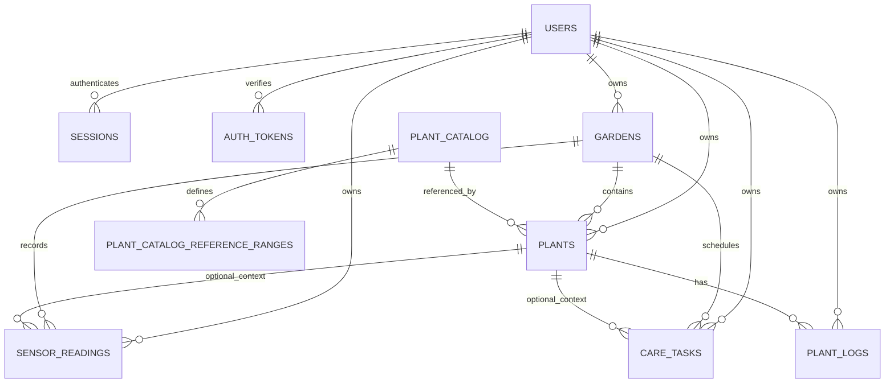

# Proposed PostgreSQL Schema — GrowSpace

Last updated: 2026-10-20

Status: proposed design for the Firebase exit. No SQL has been executed against Neon. Table, column, and constraint names are the intended migration target, subject to review.

## 1. Design decisions

1. **Neon PostgreSQL becomes the identity and application database.** Firebase is not a runtime dependency in the target design.
2. **Users have internal UUIDs.** `users.id` is the ownership key for every private record. Firebase UIDs appear only in a temporary migration mapping, never in the final ownership model.
3. **Authentication uses server-managed opaque sessions.** A random session token is stored in an `HttpOnly` cookie; only its SHA-256 hash is stored in `sessions`.
4. **Passwords use Argon2id.** The database stores an encoded Argon2id hash, never a plaintext or reversibly encrypted password.
5. **Email verification and password reset use hashed, single-use tokens.** Raw tokens exist only in the email link; `auth_tokens` stores hashes.
6. **The API is the only database client.** Browser code never receives `DATABASE_URL` or a database role that can read private rows.
7. **Server-side authorization is mandatory.** Every private query/mutation is scoped to the verified session user. Composite foreign keys enforce parent-owner consistency as defence in depth.
8. **Use text plus check constraints for enums.** Values stay aligned with shared Zod enums and avoid PostgreSQL enum migration friction.
9. **Store timezone-aware timestamps as `timestamptz`.** Date-only product fields use `date`.
10. **Keep catalog reference ranges relational.** The shared `referenceRanges` map becomes one row per measurement.
11. **Do not persist derived recommendations in the MVP.** Add a table only if acknowledgement/history becomes a product requirement.
12. **Make deletion explicit.** Deleting a user cascades private/auth records; garden deletion cascades its children; referenced catalog rows are not deleted.

PostgreSQL 15 or newer is assumed. The optional plant foreign keys use `ON DELETE SET NULL (plant_id)` to null only the plant reference while retaining `garden_id` and `user_id`. Verify the Neon server version before implementation; the fallback is a nullable plant FK plus a constraint trigger.

## 2. Entity relationship diagram

`auth_rate_limits` is an operational security table and has no user foreign key.

## 3. Authentication and ownership model

### 3.1 Users

- `users.id` is a UUID generated on registration.
- `users.email` is normalized (trimmed, lowercased) and unique.
- `users.password_hash` contains an Argon2id encoded hash (`$argon2id$...`). It is NOT NULL for every registered user account.
- `users.email_verified_at` controls verified-email policy.
- `users.display_name` and `users.temperature_unit` replace the previous unauthenticated profile concept.
- No Firebase UID, Firebase token, password reset token, or session token is stored in `users`.

### 3.2 Sessions

- Login creates a new random opaque session token, not a JWT.
- The raw token is sent only as an `HttpOnly` cookie. Only its SHA-256 hash is stored in `sessions.token_hash`.
- A session-bound CSRF token is also issued. Its hash is stored in `sessions.csrf_token_hash`.
- Session validation checks revocation, absolute expiry, and idle expiry.
- Logout revokes the current session. Password reset revokes all sessions.
- A new session is issued on login; a client-supplied session ID is never trusted.

### 3.3 Email verification and password reset tokens

- Raw tokens are 32 random bytes, base64url-encoded, and sent only in email links.
- `auth_tokens.token_hash` stores SHA-256. Raw tokens are never logged or stored.
- Both token types are single-use, expiring, and invalidated when replaced.
- Password reset also revokes all sessions and may mark the email verified after successful proof of mailbox control.

### 3.4 Ownership chain

| Record | Direct owner | Parent consistency rule |
| --- | --- | --- |
| `users` | `id` | Root of application identity |
| `sessions` | `user_id` | FK → `users(id)` on delete cascade |
| `auth_tokens` | `user_id` | FK → `users(id)` on delete cascade |
| `gardens` | `user_id` | FK → `users(id)` on delete cascade |
| `plants` | `user_id` | `(garden_id, user_id)` must reference an owned garden |
| `sensor_readings` | `user_id` | Garden must be owned; optional plant must belong to the same garden/user |
| `care_tasks` | `user_id` | Garden must be owned; optional plant must belong to the same garden/user |
| `plant_logs` | `user_id` | `(plant_id, user_id)` must reference an owned plant |
| `plant_catalog` | Team-managed | No user ownership |
| `plant_catalog_reference_ranges` | Team-managed | Parent catalog row |

The API must still verify the session and ownership on every request. Composite keys are integrity controls, not a replacement for authorization.

## 4. Authentication tables

### 4.1 `users`

| Column | Type | Null/default | Constraints |
| --- | --- | --- | --- |
| `id` | `uuid` | PK, `gen_random_uuid()` | Internal user ID |
| `email` | `text` | Not null | Unique; trimmed lowercase; length 3–254; basic shape check |
| `password_hash` | `text` | Not null | Argon2id encoded hash (`$argon2id$...`) |
| `display_name` | `text` | Null | Null or trimmed length 1–80 |
| `temperature_unit` | `text` | `'celsius'` | `celsius` or `fahrenheit` |
| `email_verified_at` | `timestamptz` | Null | Set after successful verification |
| `created_at` | `timestamptz` | `now()` | Not null |
| `updated_at` | `timestamptz` | `now()` | Not null |

Additional constraints:

- `CHECK (email = lower(btrim(email)))` — prevents duplicate case variants.
- `CHECK (char_length(email) BETWEEN 3 AND 254)`.
- A coarse email shape check, for example `position('@' in email) > 1`; full validation remains in shared Zod.
- `CHECK (password_hash LIKE '$argon2id$%')` — the database rejects non-Argon2id password hashes.
- `UNIQUE (email)`.

Per the confirmed product decision, GrowSpace starts fresh with new accounts and does not import legacy Firebase accounts. Every registered user must have an Argon2id password hash. Plaintext passwords and passwordless accounts cannot be inserted into the database.

Indexes: unique `(email)`. Primary key for sessions and ownership.

No `is_admin` role is added; the MVP has no admin product role. Catalog writes use a trusted operator/migration role.

### 4.2 `sessions`

| Column | Type | Null/default | Constraints |
| --- | --- | --- | --- |
| `id` | `uuid` | PK, `gen_random_uuid()` | Session record ID |
| `user_id` | `uuid` | Not null | FK → `users(id)` on delete cascade |
| `token_hash` | `bytea` | Not null | Unique; exactly 32 bytes (SHA-256) |
| `csrf_token_hash` | `bytea` | Not null | Exactly 32 bytes (SHA-256) |
| `created_at` | `timestamptz` | `now()` | Not null |
| `last_used_at` | `timestamptz` | `now()` | Not null; updated at most every 5 minutes |
| `expires_at` | `timestamptz` | Not null | Absolute expiry |
| `revoked_at` | `timestamptz` | Null | Non-null means revoked |

Constraints:

- `CHECK (octet_length(token_hash) = 32)`.
- `CHECK (octet_length(csrf_token_hash) = 32)`.
- `CHECK (expires_at > created_at)`.
- `CHECK (last_used_at >= created_at)`.
- `CHECK (revoked_at IS NULL OR revoked_at >= created_at)`.

Indexes:

- unique `(token_hash)` for session lookup;
- `(user_id)` for revoke-all and account deletion;
- `(expires_at)` for cleanup;
- optional `(revoked_at)` if revoked-session cleanup is separate.

The raw session token and raw CSRF token are never stored. Absolute and idle timeout defaults are application policy, documented in `docs/auth/architecture.md`; the database stores the absolute expiry and last-use timestamp.

### 4.3 `auth_tokens`

| Column | Type | Null/default | Constraints |
| --- | --- | --- | --- |
| `id` | `uuid` | PK, `gen_random_uuid()` | — |
| `user_id` | `uuid` | Not null | FK → `users(id)` on delete cascade |
| `purpose` | `text` | Not null | `email_verification` or `password_reset` |
| `token_hash` | `bytea` | Not null | Unique; exactly 32 bytes |
| `expires_at` | `timestamptz` | Not null | Short-lived |
| `consumed_at` | `timestamptz` | Null | Set atomically on use |
| `created_at` | `timestamptz` | `now()` | Not null |

Constraints:

- `CHECK (purpose IN ('email_verification', 'password_reset'))`.
- `CHECK (octet_length(token_hash) = 32)`.
- `CHECK (expires_at > created_at)`.
- `CHECK (consumed_at IS NULL OR consumed_at >= created_at)`.

Indexes:

- unique `(token_hash)`;
- `(user_id, purpose, expires_at)` for lookup/cleanup;
- partial index `(user_id, purpose) WHERE consumed_at IS NULL` to accelerate active-token queries and transactional invalidation without blocking replacement tokens when expired tokens remain unconsumed;
- `(expires_at)` for cleanup.

Token issuance supersedes prior active tokens in an atomic transaction (`UPDATE auth_tokens SET consumed_at = now() WHERE user_id = $1 AND purpose = $2 AND consumed_at IS NULL;`). Token consumption must be atomic (`UPDATE ... WHERE token_hash = $1 AND consumed_at IS NULL AND expires_at > now() RETURNING ...`). A token is invalid if expired, already consumed, replaced, or the user no longer exists.

### 4.4 `auth_rate_limits`

| Column | Type | Null/default | Constraints |
| --- | --- | --- | --- |
| `key_hash` | `bytea` | PK | Exactly 32 bytes; HMAC-SHA-256 of action/scope/identifier |
| `action` | `text` | Not null | `login`, `register`, `password_reset`, `verify_resend` |
| `window_started_at` | `timestamptz` | `now()` | Not null |
| `attempt_count` | `integer` | `0` | `>= 0` |
| `blocked_until` | `timestamptz` | Null | Temporary throttle end |
| `updated_at` | `timestamptz` | `now()` | Not null |

Constraints/notes:

- `CHECK (action IN ('login', 'register', 'password_reset', 'verify_resend'))`.
- `CHECK (octet_length(key_hash) = 32)`.
- `CHECK (attempt_count >= 0)`.
- No raw email address or IP address is stored; use a keyed HMAC with a server-only secret so keys cannot be trivially enumerated.
- This is an operational table, not a user-owned record. It has no `user_id` FK because it also covers pre-authentication requests.
- Cleanup by `updated_at`/`blocked_until` is required.
- If the deployment uses an external rate-limit store or edge WAF, this table can be omitted. The application still needs defence-in-depth limits.

## 5. Application tables

### 5.1 `plant_catalog`

| Column | Type | Null/default | Constraints |
| --- | --- | --- | --- |
| `id` | `text` | PK | Stable ID, currently `catalog-<slug>` |
| `slug` | `text` | Not null | Unique; lowercase kebab-case; immutable once referenced |
| `common_name` | `text` | Not null | Non-empty |
| `scientific_name` | `text` | Null | — |
| `category` | `text` | Not null | Non-empty; current values are `Vegetables`, `Herbs`, `Fruits` |
| `difficulty` | `text` | Null | `easy`, `moderate`, or `advanced` |
| `image_url` | `text` | Null | Null or HTTPS URL, ≤ 2,048 characters |
| `light_guidance` | `text` | Null | — |
| `watering_guidance` | `text` | Null | — |
| `growing_method_notes` | `text` | Null | — |
| `harvest_days_min` | `integer` | Null | Null or ≥ 0 |
| `harvest_days_max` | `integer` | Null | Null or ≥ 0; ≥ `harvest_days_min` when both exist |
| `reference_notes` | `text` | Null | — |
| `is_published` | `boolean` | `false` | Not null |
| `created_at` | `timestamptz` | `now()` | Not null |
| `updated_at` | `timestamptz` | `now()` | Not null |

Indexes:

- unique `(slug)`;
- `(is_published, category, common_name)` for the public listing/filter path.

Catalog IDs stay deterministic for idempotent seeding and to preserve existing `catalogId` values. Do not regenerate IDs when editing content. Writes are restricted to trusted maintainers.

### 5.2 `plant_catalog_reference_ranges`

| Column | Type | Null/default | Constraints |
| --- | --- | --- | --- |
| `plant_catalog_id` | `text` | PK part | FK → `plant_catalog(id)` on delete cascade |
| `measurement_type` | `text` | PK part | `air_temperature`, `air_humidity`, `medium_moisture` |
| `min_value` | `numeric(6,2)` | Not null | Finite; ≤ `max_value` |
| `max_value` | `numeric(6,2)` | Not null | Finite; ≥ `min_value` |

Primary key: `(plant_catalog_id, measurement_type)`. Units are derived from shared measurement metadata. Current seed data produces 36 rows (12 entries × 3 measurements).

### 5.3 `gardens`

| Column | Type | Null/default | Constraints |
| --- | --- | --- | --- |
| `id` | `uuid` | PK, `gen_random_uuid()` | — |
| `user_id` | `uuid` | Not null | FK → `users(id)` on delete cascade |
| `name` | `text` | Not null | Trimmed length 1–80 |
| `description` | `text` | Null | ≤ 500 |
| `location_label` | `text` | Null | ≤ 120; general label, not precise coordinates |
| `growing_method` | `text` | Null | `soil`, `hydroponic`, `container`, `raised_bed`, or `other` |
| `image_url` | `text` | Null | Null or HTTPS URL, ≤ 2,048 characters |
| `created_at` | `timestamptz` | `now()` | Not null |
| `updated_at` | `timestamptz` | `now()` | Not null |

Additional constraint: `UNIQUE (id, user_id)`.

Indexes:

- `(user_id, created_at DESC)`;
- unique `(id, user_id)` for ownership-preserving child references.

### 5.4 `plants`

| Column | Type | Null/default | Constraints |
| --- | --- | --- | --- |
| `id` | `uuid` | PK, `gen_random_uuid()` | — |
| `user_id` | `uuid` | Not null | FK → `users(id)` on delete cascade |
| `garden_id` | `uuid` | Not null | Composite FK → `gardens(id, user_id)` on delete cascade |
| `catalog_id` | `text` | Null | FK → `plant_catalog(id)` on delete restrict |
| `custom_name` | `text` | Null | ≤ 80; trimmed non-empty when present |
| `planting_date` | `date` | Null | — |
| `growth_stage` | `text` | `'seedling'` | `seedling`, `vegetative`, `flowering`, `fruiting`, `harvested` |
| `status` | `text` | `'active'` | `active`, `archived`, `harvested` |
| `expected_harvest_date` | `date` | Null | — |
| `actual_harvest_date` | `date` | Null | — |
| `notes` | `text` | Null | ≤ 1,000 |
| `created_at` | `timestamptz` | `now()` | Not null |
| `updated_at` | `timestamptz` | `now()` | Not null |

Additional constraints:

- `CHECK (catalog_id IS NOT NULL OR custom_name IS NOT NULL)` — a plant must have a library reference or a custom name.
- `UNIQUE (id, garden_id, user_id)`.
- `UNIQUE (id, user_id)`.

Indexes:

- `(user_id, created_at DESC)`;
- `(garden_id, user_id, created_at DESC)`;
- `(catalog_id)`.

Catalog deletion is restricted. Retire entries with `is_published = false`; existing plants keep their historical reference.

### 5.5 `sensor_readings`

| Column | Type | Null/default | Constraints |
| --- | --- | --- | --- |
| `id` | `uuid` | PK, `gen_random_uuid()` | — |
| `user_id` | `uuid` | Not null | FK → `users(id)` on delete cascade |
| `garden_id` | `uuid` | Not null | Composite FK → `gardens(id, user_id)` on delete cascade |
| `plant_id` | `uuid` | Null | Composite FK → `plants(id, garden_id, user_id)` |
| `measurement_type` | `text` | Not null | `air_temperature`, `air_humidity`, `medium_moisture` |
| `value` | `numeric(6,2)` | Not null | Plausible range per measurement |
| `unit` | `text` | Not null | Must match measurement type |
| `source` | `text` | Not null | `simulated`, `manual`, `sensor` |
| `recorded_at` | `timestamptz` | Not null | User-visible event time |
| `note` | `text` | Null | ≤ 500 |
| `created_at` | `timestamptz` | `now()` | Not null |

Measurement/unit/range constraint:

- `air_temperature`: unit `°C`, value between -20 and 70;
- `air_humidity`: unit `%`, value between 0 and 100;
- `medium_moisture`: unit `%`, value between 0 and 100.

Plant reference behavior:

- `FOREIGN KEY (plant_id, garden_id, user_id) REFERENCES plants(id, garden_id, user_id) ON DELETE SET NULL (plant_id)`.
- Keeps historical garden readings when a plant is removed; prevents referencing another user's plant.
- If column-list `SET NULL` is unavailable, use a nullable plant FK plus an integrity trigger.

Source integrity remains an application rule:

- User-facing write routes may create `manual` readings only.
- `simulated` records are created by a trusted seed process.
- `sensor` remains reserved until verified device integration.
- The database label check cannot prove a device produced the data.

Indexes:

- `(garden_id, recorded_at DESC)`;
- `(garden_id, measurement_type, recorded_at DESC)`;
- `(user_id, recorded_at DESC)`;
- `(plant_id, recorded_at DESC)`.

### 5.6 `care_tasks`

| Column | Type | Null/default | Constraints |
| --- | --- | --- | --- |
| `id` | `uuid` | PK, `gen_random_uuid()` | — |
| `user_id` | `uuid` | Not null | FK → `users(id)` on delete cascade |
| `garden_id` | `uuid` | Not null | Composite FK → `gardens(id, user_id)` on delete cascade |
| `plant_id` | `uuid` | Null | Composite FK → `plants(id, garden_id, user_id)` |
| `title` | `text` | Not null | Trimmed length 1–120 |
| `task_type` | `text` | `'other'` | `watering`, `fertilizing`, `inspect`, `harvest`, `other` |
| `description` | `text` | Null | ≤ 1,000 |
| `due_at` | `timestamptz` | Null | — |
| `status` | `text` | `'pending'` | `pending`, `completed`, `cancelled` |
| `completed_at` | `timestamptz` | Null | Set iff status is `completed` |
| `priority` | `text` | `'normal'` | `low`, `normal`, `high` |
| `created_at` | `timestamptz` | `now()` | Not null |
| `updated_at` | `timestamptz` | `now()` | Not null |

Additional constraints:

- `CHECK ((status = 'completed') = (completed_at IS NOT NULL))`.
- Composite plant FK uses `ON DELETE SET NULL (plant_id)`; the task remains attached to its garden.

Indexes:

- `(user_id, status, due_at)`;
- `(garden_id, status, due_at)`;
- `(user_id, due_at)`;
- `(plant_id, due_at)`.

### 5.7 `plant_logs`

| Column | Type | Null/default | Constraints |
| --- | --- | --- | --- |
| `id` | `uuid` | PK, `gen_random_uuid()` | — |
| `user_id` | `uuid` | Not null | FK → `users(id)` on delete cascade |
| `plant_id` | `uuid` | Not null | Composite FK → `plants(id, user_id)` on delete cascade |
| `log_type` | `text` | `'note'` | `growth`, `care`, `harvest`, `note` |
| `title` | `text` | Null | ≤ 120 |
| `content` | `text` | Not null | Trimmed length 1–2,000 |
| `logged_at` | `timestamptz` | Not null | User-visible event time |
| `created_at` | `timestamptz` | `now()` | Not null |

Indexes:

- `(plant_id, logged_at DESC)`;
- `(user_id, logged_at DESC)`.

Logs cascade when their plant is deleted.

### 5.8 Shared domain check constraints

Add explicit checks so the database rejects values the shared Zod contracts would reject:

- `plant_catalog.difficulty IN ('easy', 'moderate', 'advanced')` when not null.
- `plant_catalog.harvest_days_max >= harvest_days_min` when both are present.
- `gardens.growing_method IN ('soil', 'hydroponic', 'container', 'raised_bed', 'other')` when not null.
- `plants.growth_stage IN ('seedling', 'vegetative', 'flowering', 'fruiting', 'harvested')`.
- `plants.status IN ('active', 'archived', 'harvested')`.
- `sensor_readings.measurement_type IN ('air_temperature', 'air_humidity', 'medium_moisture')`.
- `sensor_readings.source IN ('simulated', 'manual', 'sensor')`.
- `care_tasks.task_type IN ('watering', 'fertilizing', 'inspect', 'harvest', 'other')`.
- `care_tasks.status IN ('pending', 'completed', 'cancelled')`.
- `care_tasks.priority IN ('low', 'normal', 'high')`.
- `plant_logs.log_type IN ('growth', 'care', 'harvest', 'note')`.

Keep these values synchronized with `packages/shared`; a shared enum change requires a migration and test update.

## 6. Delete behavior

| Operation | Database behavior | Product requirement |
| --- | --- | --- |
| Delete user | Cascades sessions, auth tokens, gardens, plants, readings, tasks, logs | Account deletion is not implemented yet; define before enabling |
| Delete session | Row-level revoke/delete | Logout, password reset, account security |
| Delete auth token | Row-level consume/delete | Token use, expiry cleanup |
| Delete garden | Cascades plants, readings, tasks; logs cascade through plants | Confirmation must state children are removed |
| Delete plant | Cascades logs; readings/tasks keep garden context with `plant_id = NULL` | Confirmation must explain retained history |
| Delete catalog entry | Blocked when referenced by plants (`RESTRICT`) | Unpublish instead |
| Delete reading/log/task | Owner-authorized delete | Confirm destructive action |

Deleting a user is a destructive multi-table operation. If account deletion is added, the API should perform it in a transaction and confirm clearly. Cross-system cleanup is no longer needed after Firebase exit.

## 7. Authorization and database security

### 7.1 Mandatory controls

- `requireSession()` validates the opaque cookie against `sessions` and loads `users`.
- `user_id` comes only from the verified session, never from a request body/query.
- Every private query is scoped by `user_id`; direct object lookups use `id + user_id`.
- Before child mutations, the API verifies that the referenced garden/plant belongs to the session user. Composite foreign keys are a second check.
- Public catalog reads expose published rows only.
- Private routes return safe errors and `Cache-Control: no-store`.
- Logout revokes the session; password reset revokes all sessions.
- The browser receives no database credential.

### 7.2 RLS decision

The original product documentation mandates RLS because Supabase clients can reach PostgreSQL directly. In this architecture, the browser never reaches PostgreSQL and all access goes through the Next.js API.

Proposed initial decision: **use a least-privilege server-only database role and enforce authorization in API repositories; do not rely on client-side checks.** RLS can be added as defence in depth later using a per-transaction identity setting, but it is not a substitute for server checks.

If RLS is required:

1. The runtime role must not own tables and must not have `BYPASSRLS`.
2. API repositories open a transaction and set a local user context.
3. Policies compare `user_id`/parent ownership with that context.
4. Auth/session lookup tables need carefully designed policies or security-definer functions; do not accidentally create a broad bypass.
5. Policies and two-account tests are versioned with the schema.

RLS becomes mandatory if any browser/direct client ever receives a database connection or if a Neon Data API path is introduced.

## 8. Index rationale

| Index | Purpose |
| --- | --- |
| unique `users(email)` | Login/registration lookup and uniqueness |
| unique `sessions(token_hash)` | Fast session validation |
| `sessions(user_id)` | Revoke all sessions |
| `sessions(expires_at)` | Cleanup |
| unique `auth_tokens(token_hash)` | Verification/reset lookup |
| `auth_tokens(user_id, purpose, expires_at)` | Active-token management |
| unique partial token index | At most one active token per purpose |
| `auth_rate_limits(updated_at)` | Cleanup |
| `gardens(user_id, created_at DESC)` | Garden list |
| `plants(user_id, created_at DESC)` | “My Plants” |
| `plants(garden_id, user_id, created_at DESC)` | Garden detail and cascade checks |
| `plants(catalog_id)` | Catalog reference checks |
| `readings(garden_id, recorded_at DESC)` | Garden history |
| `readings(garden_id, measurement_type, recorded_at DESC)` | Measurement chart |
| `readings(user_id, recorded_at DESC)` | Recent activity |
| `readings(plant_id, recorded_at DESC)` | Plant history |
| `care_tasks(user_id, status, due_at)` | Open tasks |
| `care_tasks(garden_id, status, due_at)` | Garden tasks |
| `care_tasks(user_id, due_at)` | Today/upcoming |
| `care_tasks(plant_id, due_at)` | Plant tasks |
| `plant_logs(plant_id, logged_at DESC)` | Plant timeline |
| `plant_logs(user_id, logged_at DESC)` | Recent logs |
| `plant_catalog(is_published, category, common_name)` | Public catalog |
| unique `plant_catalog(slug)` | Public lookup |

Validate key queries with `EXPLAIN (ANALYZE, BUFFERS)` after repositories exist and remove unused indexes. Preserve indexes needed for FK cascade/cleanup.

## 9. Domain-to-schema mapping

| Shared type / current source | PostgreSQL target | Notes |
| --- | --- | --- |
| Firebase Auth user | `users` | New internal UUID |
| `Profile.id` | `users.id` | No longer a Firebase UID |
| `Profile.displayName` | `users.display_name` | Profile data merged into users |
| `Profile.temperatureUnit` | `users.temperature_unit` | Previously unsaved |
| Firebase session | `sessions` | Opaque cookie token |
| Firebase reset/verification | `auth_tokens` | Hashed, single-use |
| `Garden.userId` | `gardens.user_id` | UUID |
| `Plant.userId` | `plants.user_id` | UUID |
| `SensorReading.userId` | `sensor_readings.user_id` | UUID |
| `CareTask.userId` | `care_tasks.user_id` | UUID |
| `PlantLog.userId` | `plant_logs.user_id` | UUID |
| `PlantCatalogEntry.referenceRanges` | `plant_catalog_reference_ranges` rows | Normalized |
| `Recommendation` | No table | Derived |

## 10. Seed and migration assumptions

- Seed 12 catalog entries and 36 reference ranges deterministically from `packages/shared/src/catalog.ts`.
- Use `catalog-<slug>` IDs and slugs; upsert by ID/slug.
- Keep the static catalog as fallback until database reads are verified.
- Do not seed user-owned demo rows in this schema plan; demo data is a later, labeled step.
- Confirmed product decision: GrowSpace has no existing Firebase user accounts or user data that need migration. The application starts fresh with new user registrations.
- No temporary UID mapping table (`legacy_firebase_user_map`) or bulk password-reset campaign is needed.
- Every user account requires an email address and an Argon2id password hash upon registration.

## 11. Open schema decisions

1. Email-verification enforcement point (allow login / block writes recommended).
2. Session absolute/idle timeouts and periodic rotation.
3. RLS timing.
4. Account deletion and self-service password change scope.
5. Plant deletion behavior for tasks (retained with `plant_id = NULL`).
6. Retention period for revoked/expired auth rows before cleanup.
7. External rate-limit store versus `auth_rate_limits`.
